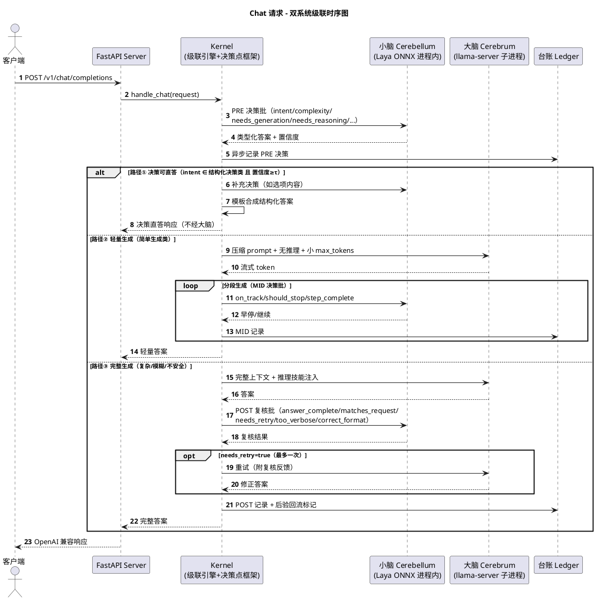
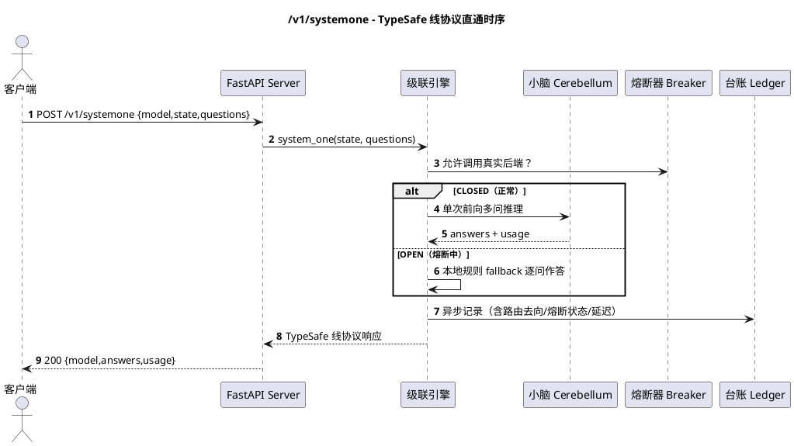
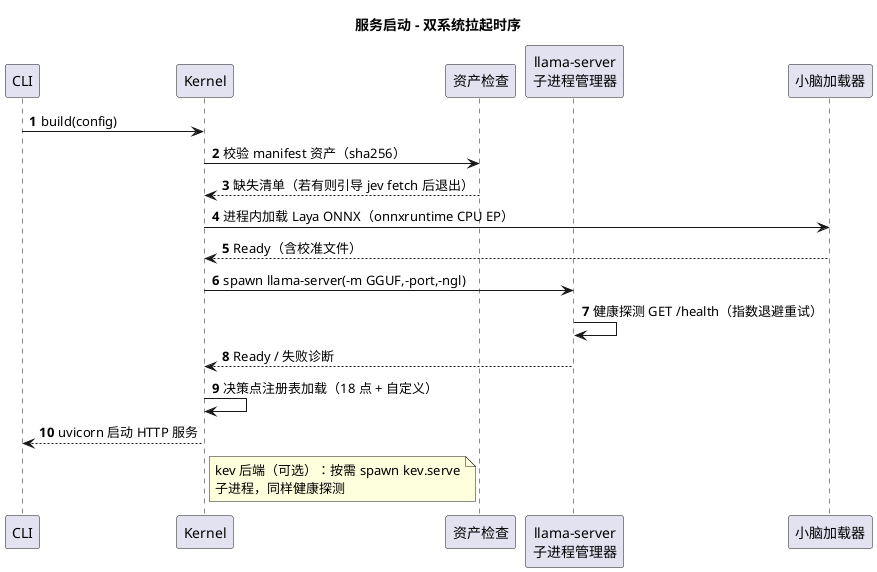
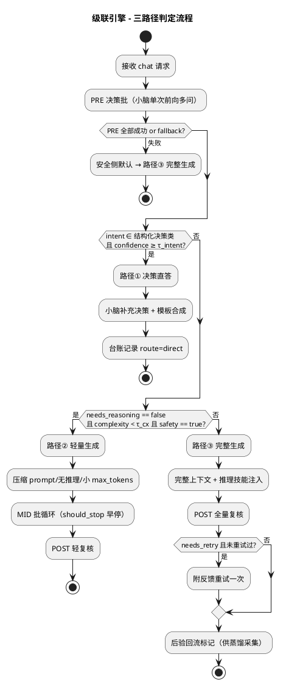
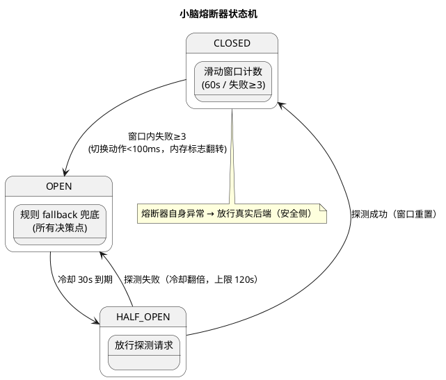
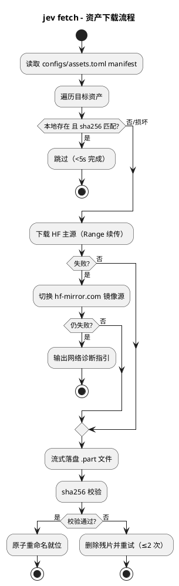
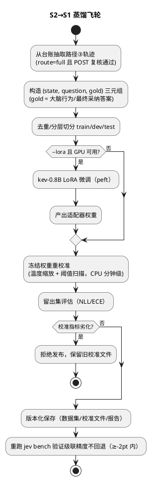
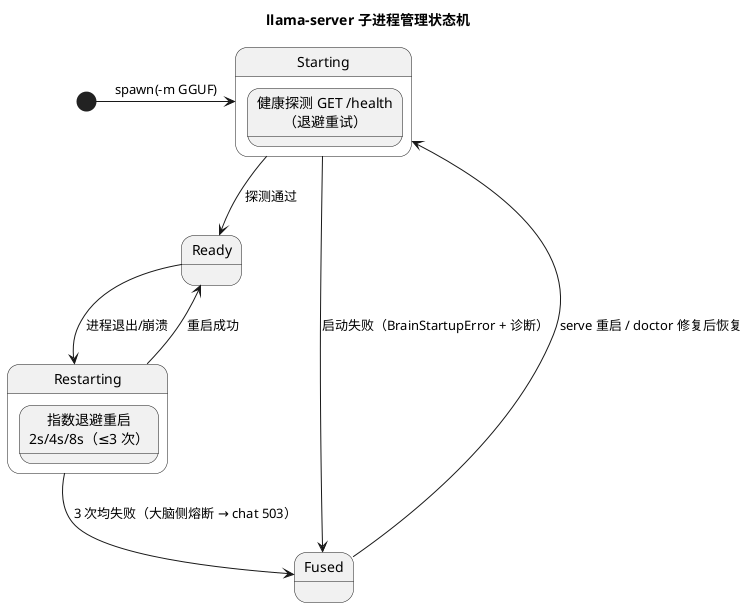

# 1 AR概述

| 组件名称 | Jev Runtime（`src/jev`，Python 包，组件详设见 `specs/component-detail-design/jev_spec.md`） |
| --- | --- |
| AR系统流水号 | AR001 |
| AR描述 | 端侧 Jev+LLM 双系统运行时 M1–M3：以可嵌入 Kernel 为核心，实现快思考小脑（类型化决策模型，Laya ONNX 进程内 + kev 子进程可插拔）与慢思考大脑（llama-server 子进程 + Qwen2.5 GGUF）的置信门控级联协同，含 18 决策点框架（PRE/MID/POST 三态）、决策台账、熔断降级、模型资产 fetch、CLI/SDK/MCP 四形态交付、S2→S1 蒸馏飞轮与评测基准。全量真实后端，无任何 mock。 |

# 2 动态行为

## 2.1 交互时序图

### 2.1.1 Chat 请求三路径级联时序（核心场景）



### 2.1.2 systemone 请求时序（小脑单系统）



### 2.1.3 `jev serve` 启动编排时序



# 3 功能点分解

| 序号 | 功能点名称 | 功能点描述 |
| --- | --- | --- |
| 1 | FR1 双协议 HTTP 端点 | `/v1/systemone`（TypeSafe 严格线协议）+ `/v1/chat/completions`（OpenAI 兼容，非流式先行）+ `/health` |
| 2 | FR2 小脑双后端 | `CerebellumBackend` 抽象 + Laya ONNX 进程内实现（默认）+ kev-0.8B 子进程实现（可插拔） |
| 3 | FR3 大脑子进程管理 | llama-server 生命周期（拉起/健康检查/自动重启≤3 次/优雅退出）+ OpenAI 客户端 |
| 4 | FR4 决策点框架 | DecisionPoint 注册表，18 内置点（PRE9/MID4/POST5），active/shadow/off 三态，声明式 TOML 定义 + 编程注册 |
| 5 | FR5 置信门控级联 | 三路径路由（决策直答/轻量生成/完整生成）、τ 按点可配、后验回流信号、安全侧默认升级 |
| 6 | FR6 熔断降级 | 滑动窗口熔断器（60s 内 3 失败→OPEN，30s 后 HALF_OPEN 探测），规则 fallback，切换 <100ms |
| 7 | FR7 模型资产 fetch | manifest 驱动，HF→hf-mirror 回退，sha256 校验，断点续传，<5s 跳过已就位资产 |
| 8 | FR8 决策台账 | JSONL 异步落盘（<1ms 主路径开销），request_id 聚合检索，含 shadow/熔断/路由标记 |
| 9 | FR9 CLI 套件 | `jev serve/fetch/doctor/bench/distill` |
| 10 | FR10 Python SDK | `JevClient`（httpx 同步+异步）+ 类型化结果对象 + DecisionPoint 编程 API |
| 11 | FR11 MCP Server | decide/judge/rate 三 tools，stdio transport |
| 12 | FR12 蒸馏飞轮 | 台账→(state,question,gold) 数据集→冻结权重校准（CPU 分钟级）→可选 kev LoRA（GPU）→复测 |
| 13 | FR13 评测基准 | 延迟分布/命中率/精度保持/成本曲线/决策点开销分解，JSON+Markdown 报告 |

# 4 实现设计

## 4.1 功能实现思路

**总体：方案 C「可嵌入内核 + 可选守护」**——核心是进程内 `Kernel` 对象图（小脑后端池 + 决策点框架 + 级联引擎 + 熔断器 + 台账），Server/CLI/SDK/MCP 皆为薄壳；重资产（大脑 llama-server、kev 小脑）子进程托管。一套代码覆盖三种部署：嵌入式（SDK 进程内）、服务式（`jev serve`）、守护式（`--daemon`）。

**架构方案对比（决策记录）：**

| 维度 | 方案 A：单体服务式（DuoMind 同构） | 方案 B：全守护进程式（ollaya 同构） | 方案 C：可嵌入内核+可选守护 ★选定 |
| --- | --- | --- | --- |
| 形态 | FastAPI 进程包办一切 | 小脑/网关/大脑三进程常驻，全走 HTTP | 进程内 Kernel；serve/daemon 按需常驻 |
| 小脑调用延迟 | 进程内（零跳转） | +1 次 HTTP 跳转（1–3ms） | 进程内（零跳转，默认路径） |
| P50 预算 | 可满足 | 跳转+序列化侵蚀预算 | 可满足（小脑预算 AR001 修订为 ≤600ms，kev 第二后端放宽至 ≤800ms） |
| SDK 嵌入 | 不可（必须起服务） | 不可 | 原生支持（Kernel 即库） |
| 隔离性 | 弱（小脑与 Web 同进程） | 强 | 大脑/kev 子进程隔离；小脑 ONNX 进程内（只读推理且释放 GIL，可接受） |
| 部署复杂度 | 低 | 高（三进程编排） | 低→中（单 pip 包，--daemon 可选） |
| M4 车机演进 | 需重构为库 | 需裁剪进程模型 | Kernel 直接复用 |
| 可测试性 | 好 | 中（多进程夹具） | 好（进程内直测 + assets 标记） |

**否决理由**：A 牺牲嵌入与复用（M4 车机/SDK 场景返工）；B 的网络跳转与编排复杂度违背端侧延迟预算与轻部署诉求。C 是唯一同时满足「零跳转级联 + 可嵌入 + 重资产隔离可选」的方案，且向后兼容 A/B 两种部署形态。

**集百家之长（模式→来源→本设计落点）：**

| 来源 | 借鉴 | 落点 |
| --- | --- | --- |
| TypeSafe Jev | `/v1/systemone` 线协议 | `server/systemone.py` 严格字段对齐 |
| DuoMind | 18 决策点三阶段 / 熔断参数 / 技能注入 | `decisions/builtin.py`、`cascade/breaker.py`、路径③推理技能 |
| hermes-jev-skills | shadow mode / 决策台账 / 「小脑做选择不做创作」 | 三态设计、`ledger/`、路径①只做结构化合成 |
| ollaya | 拉取-服务范式 / Modelfile | `fetch/` manifest、`configs/` 声明式资产 |
| von | 置信门控 0.80 校准 / `calibrate` 冻结重校准 / Noul 带 | `cascade/engine.py` 阈值机制、`distill/calibrate.py` |
| OpenJev | 「explore first, crystallize later」飞轮 | `distill/` 轨迹→数据集→校准闭环 |
| kev | 决策模型质量基准 / systemone 服务实现 | kev 后端适配其 `/v1/systemone` 服务 |

**关键设计决策：**
1. **同步内核/异步外壳分离**：Kernel 核心路径为同步代码（onnxruntime 释放 GIL），FastAPI 处理器经 `asyncio.to_thread` 调用；台账写入走独立写线程 + `queue.Queue`（主路径仅 `put_nowait`，<1ms）。
2. **小脑进程内默认**：级联零网络跳转，保小脑低延迟（P50 预算 AR001 修订为 ≤600ms，见 §4.5）；kev 走子进程 HTTP（`httpx`），延迟预算放宽（P50≤800ms，仅第二后端）。
3. **chat 三路径语义**（关键澄清）：小脑**不生成散文**。路径①= 结构化决策类意图（分类/路由/评分/判断）由小脑直答+模板合成；路径②/③均由大脑生成，差异在 prompt 压缩、思考预算、token 上限、MID 早停与 POST 复核深度。级联命中率=路径①+②占比，「不经大脑」严格口径=路径①。
4. **声明式决策点**：18 点定义于 `configs/decision-points.toml`（id/stage/question 模板/τ/action 映射/默认态），框架只认注册表；运行态可被 SDK 编程覆盖。
5. **配置单源**：`configs/jev.toml`（TOML，DuoMind 同构），含后端选择/模型路径/端口/级联阈值/熔断参数。
6. **测试无 mock 策略**：纯逻辑（熔断状态机/阈值路由/manifest 解析/台账格式）直接单测；涉及后端的一律真实资产（Laya CPU 快速前向；llama-server/kev 用 `pytest.mark.assets`+`slow` 标记，`jev fetch --all` 为前置）。

## 4.2 功能实现设计

### 4.2.1 流程图

#### A. 级联三路径判定（FR5 核心）



#### B. 熔断器状态机（FR6）



#### C. 资产 fetch（FR7）



#### D. 蒸馏飞轮（FR12）



#### E. 大脑子进程管理状态机（FR3）



### 4.2.2 流程说明

**正常流程**：见 2.1 时序与上述流程图。路径①延迟目标 <700ms（含模板合成；AR001 返工修订，原 <50ms，依据 §4.5）；路径②为延迟优化主力；路径③保证质量。

**异常流程（强制说明）**：
1. **小脑推理超时/异常**：单次决策异常由决策点级 fallback 接管并记台账 `mode=fallback`；60s 窗口 3 次失败触发熔断 OPEN，期间所有决策点走规则 fallback（确定性规则：各决策点 TOML 内 `fallback_action`），**端到端请求永不因小脑失败而失败**。
2. **大脑（llama-server）崩溃**：管理器指数退避自动重启（上限 3 次，间隔 2s/4s/8s）；重启期间 chat 请求返回 503+Retry-After；超过上限进入大脑侧熔断，`jev doctor` 给出诊断。
3. **大脑生成超时**：路径②/③ 设置总时长上限（配置项，默认 120s），超时截断并走 POST `correct_format` 降级响应。
4. **POST 复核 needs_retry**：仅允许一次重试（附复核反馈注入 prompt），二次失败则以当前答案交付并标注 `degraded=true`。
5. **台账磁盘写失败**：写线程捕获异常、丢弃该条并累计告警计数（不阻塞主路径）；连续 100 条失败输出 stderr 告警。
6. **fetch 网络中断**：`.part` 断点续传；校验失败残片重试 ≤2 次后终止并列出可手动下载 URL。
7. **kev 子进程不可用**：级联引擎对第二后端调用失败自动回退默认 Laya 后端并记台账 `backend_fallback=true`。

## 4.3 接口描述

### 4.3.1 对外 HTTP 接口（TypeSafe 线协议，严格对齐）

**POST /v1/systemone**

请求（必选/可选字段全表）：

| 字段 | 类型 | 必选 | 说明 |
| --- | --- | --- | --- |
| model | string | 是 | 如 `laya-1.0` / `kev-latest`（未知模型按默认后端处理并回写实际 model） |
| state | string \| object | 是 | 非结构化状态（文本或 JSON） |
| questions | object | 是 | `{name: {type, instructions, criteria}}`，≥1 问 |
| questions[].type | enum | 是 | `choice` / `noul` / `score` |
| questions[].instructions | string | 是 | 问题指令 |
| questions[].criteria | object \| array | choice/score 必选 | choice：`{label: 描述}`；score：有序等级数组（低→高） |

响应 200：

| 字段 | 类型 | 说明 |
| --- | --- | --- |
| model | string | 实际服务模型 |
| answers.{name} | object | 每问一答：choice→`{type,choice,confidence,probabilities}`；noul→`{type,noul}`；score→`{type,score,confidence,legend,probabilities}` |
| usage.input_tokens | int | 真实 tokenizer 计数 |
| truncation | object（可选） | 超长 state 截断标记（对齐 von：60% 头+40% 尾） |

错误码：`400`（非法 questions 结构，错误体含字段级 message）；`422`（`--on-overflow refuse` 模式下超长 state）；`503`（服务未就绪，含 Retry-After）。

**POST /v1/chat/completions**（OpenAI Chat 兼容）

请求字段（透传 OpenAI 规范，关键项）：

| 字段 | 类型 | 必选 | 说明 |
| --- | --- | --- | --- |
| messages | array | 是 | OpenAI 消息数组（role/content），空或角色非法 → 400 |
| model | string | 否 | 忽略具体值路由到本地大脑；缺省用配置默认 |
| temperature / max_tokens / stop | number/int/array | 否 | 透传；路径②按级联策略收紧 max_tokens |
| stream | bool | 否 | M1 非流式；M2（T013）支持 SSE chunk 格式 |

响应：OpenAI 标准字段（id/object/created/model/choices/usage）+ 扩展头 `X-Jev-Route`（direct/light/full）、`X-Jev-Decisions`（决策次数）；路径①返回模板合成的结构化答案（choices 内文本）。

错误码：`400`（messages 非法，OpenAI 规范错误体 `{error:{message,type,param,code}}`）；`429`（并发超限，仅 chat 端点）；`503`（大脑熔断/重启中或服务过载，含 Retry-After——过载统一口径，与 srs FR1 一致）。

**GET /health**：`{status, cerebellum, cerebrum, breaker, uptime}`。

### 4.3.2 CLI 接口

| 命令 | 参数 | 行为 |
| --- | --- | --- |
| `jev serve` | `--config`, `--host/--port`, `--daemon` | 构建 Kernel 并启动服务（2.1.3 时序） |
| `jev fetch` | `<asset>` / `--all`, `--force` | manifest 资产拉取（流程图 C） |
| `jev doctor` | - | 体检：Python/GPU/内存/资产 sha256/llama-server 可执行/端口占用 |
| `jev bench` | `--full`, `--out`, `--set` | 基准套件（FR13），输出 JSON+Markdown |
| `jev distill` | `--calibrate` / `--lora`, `--min-samples` | 蒸馏飞轮（流程图 D），默认 min-samples=500 |

### 4.3.3 SDK 接口（FR10）

```python
class JevClient:            # httpx 双模（sync/async）
    def decide(state, choices: dict, instructions) -> ChoiceResult
    def judge(state, instructions, criteria=None) -> NoulResult
    def rate(state, criteria: list, instructions) -> ScoreResult
    def system_one(state, questions: dict) -> SystemOneResponse
    def chat(messages, **kw) -> ChatResult

@dataclass ChoiceResult: choice: str; confidence: float; probabilities: dict
@dataclass NoulResult:   noul: float
@dataclass ScoreResult:   score: float; confidence: float; legend: dict

# 编程注册（与 TOML 等价）
jev.register_point(DecisionPoint(id="my_gate", stage=PRE, question=..., tau=0.7, mode=SHADOW, fallback_action=...))
```

**异常契约**：SDK 与 Kernel 内部接口统一抛 `JevError` 类型化异常族——`JevUnavailableError`（后端不可达/超时）、`JevProtocolError`（响应不符合线协议）、`JevAssetError`（资产缺失/校验失败）；SDK 不吞异常，向上透传。

### 4.3.4 MCP 工具（FR11）

`jev_decide(state, choices, instructions)` / `jev_judge(state, instructions, criteria)` / `jev_rate(state, criteria, instructions)`，stdio transport，返回结构化 JSON。

### 4.3.5 内部接口（Kernel 组件契约）

```python
class CerebellumBackend(ABC):
    def system_one(self, state, questions: dict) -> SystemOneResponse   # 单次前向多问
    def name(self) -> str; def warmup(self) -> None
class CerebrumBackend(ABC):
    def chat(self, messages, *, max_tokens, stop, skill) -> ChatResult  # 非流式先行
    def health(self) -> bool
class DecisionPoint:        # id, stage, question, tau, mode, fallback_action, on_answer(callable)
class CascadeEngine:
    def route_chat(self, pre: DecisionBatch) -> Route                    # 三路径判定
    def handle_mid(self, seg: Segment) -> MidAction                      # 早停/继续
    def handle_post(self, ans, post: DecisionBatch) -> PostVerdict       # 采纳/重试/降级
class Breaker: allow() -> bool; record(ok: bool); state -> CLOSED/OPEN/HALF_OPEN
class Ledger: log(entry) -> None   # 异步；query(request_id) -> list[Entry]
class AssetFetcher: fetch(name, force=False) -> Path; verify(name) -> bool
class Distiller: build_dataset(ledger, min_samples) -> Dataset; calibrate(ds) -> CalibrationReport
```

**异常契约**：内部接口遵循 §4.3.3 的 `JevError` 族；`CerebrumBackend` 启动失败额外抛 `BrainStartupError`（携带诊断信息供 `jev doctor` 展示）；`AssetFetcher` 校验失败抛 `JevAssetError`。

## 4.4 代码设计

**目录结构（MVP 向进程内 Kernel 靠拢，单包分层）：**

```
jev/ (repo root)
├── pyproject.toml          # uv 管理；依赖：fastapi, uvicorn, httpx, onnxruntime, typer, tomli(w), mcp, pytest
├── README.md  AGENTS.md  .gitignore  .python-version
├── configs/
│   ├── jev.toml                    # 服务/后端/阈值/熔断配置
│   ├── decision-points.toml        # 18 点声明式定义
│   ├── assets.toml                 # 模型资产 manifest（url/mirrors/sha256）
│   └── bench-set.yaml              # 基准问题集（简单:复杂=7:3 标注）
├── models/                 # gitignored，fetch 落位目录
├── data/ledger/            # gitignored，台账 JSONL
├── src/jev/
│   ├── kernel/             # ★进程内内核（同步核心）
│   │   ├── cerebellum/     # base.py / laya_onnx.py / kev_http.py / registry.py
│   │   ├── cerebrum/       # llama_server.py(子进程管理) / client.py
│   │   ├── decisions/      # framework.py(注册表/三态) / builtin.py(18点) / fallback.py
│   │   ├── cascade/        # engine.py(三路径) / breaker.py(状态机)
│   │   ├── ledger/         # writer.py(队列写线程) / query.py
│   │   └── kernel.py       # Kernel 门面（组合根）
│   ├── server/             # app.py / systemone.py / chat.py / schemas.py
│   ├── sdk/                # client.py / results.py / programming.py
│   ├── cli/                # main.py(typer) / serve.py / fetch_cmd.py / doctor.py / bench_cmd.py / distill_cmd.py
│   ├── mcp_server/         # server.py(FastMCP)
│   ├── fetch/              # manifest.py / downloader.py(resume/sha256/proxy)
│   ├── distill/            # dataset.py / calibrate.py / lora.py / report.py
│   └── bench/              # runner.py / metrics.py / report.py
└── tests/
    ├── unit/               # 纯逻辑（无后端依赖）
    ├── integration/        # 真实资产（pytest.mark.assets）
    └── e2e/                # 端到端三路径/熔断/蒸馏（pytest.mark.assets, slow）
```

```plantuml
@startuml
package "jev" {
  package "server（薄壳）" { [FastAPI app] as srv
    [systemone.py] as so
    [chat.py] as ch }
  package "sdk/cli/mcp（薄壳）" { [JevClient] as sdk
    [typer CLI] as cli
    [FastMCP] as mcp }
  package "kernel（进程内内核）" {
    [Kernel 门面] as k
    package "cerebellum" { [Laya ONNX(进程内)] as laya
      [kev HTTP(子进程)] as kev }
    package "cerebrum" { [llama-server 管理器] as brain }
    [决策点注册表] as dp
    [级联引擎] as cas
    [熔断器] as brk
    [台账] as lg }
  package "基础设施" { [AssetFetcher] as fe
    [Distiller] as di
    [Bench] as be }
}
srv ..> k
sdk ..> k
cli ..> k
mcp ..> k
k *-- laya
k *-- kev
k *-- brain
k *-- dp
k *-- cas
cas --> dp
cas --> brk
cas --> lg
dp --> laya
@enduml
```

**模块化要点**：kernel 不依赖 server/sdk/cli（依赖倒置，薄壳单向依赖内核）；cerebellum/cerebrum 通过 ABC 替换（Laya/kev 可插拔）；fetch/distill/bench 依赖 kernel 公共类型但独立演进（对应 M3）。

# 4.5 性能预算返工记录（AR001 实测，2026-10-23）

**结论：原「小脑 P50<20ms」预算在本机（Quadro RTX 5000 16GB / Windows WDDM / 驱动 556.18 CUDA 12.5）对现有 laya.onnx 资产不可达。经用户决策（返工选项：修订指标+继续），FR2-3 修订为 CPU EP P50≤600ms / P95≤1.5s，kev 第二后端放宽至 P50≤800ms。资产形态根因列为后续独立 spike。**

实测矩阵（真实 laya.onnx + 真实 tokenizer，本机实测）：

| 执行路径 | 实测 P50 | 判定 |
| --- | --- | --- |
| CPU EP（ORT CPU 版，16 核，seq≈40 / seq≈256） | 185ms / ≈1110ms | 短 state 可达 ≤600ms；加线程无益（16 线程反而 270ms） |
| CUDA EP（ORT 1.20.2/1.23.2/1.26.0 可用配方） | 215ms~1075ms | launch 开销主导：图含 ~5000 节点执行/次，WDDM 每次发射 ~40µs |
| CUDA graph（launch 开销正解；微型模型验证 0.07ms 正常） | laya 模型 IMA 崩溃 | ORT 1.20.2/1.23.2/1.26.0 三版一致；1.26 明确警告模型含 CPU shape 节点 |
| DirectML EP | Reshape E_INVALIDARG | 弃用（dynamo 导出图不兼容） |
| TensorRT EP | 不可用 | Windows 无 pip wheel；sdist 需直连 NVIDIA 源（代理不通） |
| ORT ≥1.29 | 不可用 | 已切 CUDA 13（cublas64_13），与本机 CUDA 12.5 驱动不兼容 |

**根因**：上游 laya.onnx 为 dynamo 动态形状导出——图内含 **489 个 CPU 回退的 shape 记账节点**（Slice/Concat/sym_size_int）与 4524 个 CUDA 节点交错执行：① 每次推理产生大量 CPU↔GPU 拷贝/同步（GPU 纯计算仅 ~25ms，其余全为发射与同步开销）；② 破坏 CUDA graph 捕获（replay 时非法访存）。**纯 GPU 计算能力本身充裕（~25ms@seq40），瓶颈全在资产工件形态，非运行时代码可修。**

**修订后性能口径**：
- FR2-3（srs §3.2/§4）：CPU EP P50≤600ms / P95≤1.5s（短 state 基准集，seq≈40 实测 185ms 留 3 倍余量）
- kev 第二后端：P50≤800ms（原 150ms 同因不可达；HTTP+子进程开销叠加）
- FR5-1「直答 P50≤大脑×1/3」保持：大脑路径（llama-server 生成）秒级，600ms 直答仍满足
- 熔断切换 <100ms、命中率 ≥70% 等其余指标不受影响

**部署配方沉淀（Windows CUDA EP 可用配置，供后续 spike/AR 复用）**：ORT 1.26.0（CUDA 12 系）+ DLL 就位（cudart64_12/cublas64_12/cublasLt64_12 + cuDNN 9 + cufft64_11，pip `nvidia-cudnn-cu12`/`nvidia-cufft-cu12` 或 llama-server 资产 cudart 目录提供）。注意 ORT 默认不携带这些 DLL，需 add_dll_directory 或同目录放置。

**后续 spike 建议（独立于本 AR）**：laya 静态形状重导出（固定 seq 长度 + 固定 K，消除 shape 记账节点）→ CUDA graph 可捕获 → 预估 P50≈10ms 级。属资产生成链路，超出「资产仅 fetch」原则，需单独立项。

# 4.6 合规审查驱动的口径修订与 MVP 裁剪（2026-10-24 review）

合规审查（S/D/C 维度）发现的实现/设计偏差，经用户决策处置如下：

**已补实现（对齐设计）**：
- EX-04 大脑生成超时：`[cascade] generation_timeout_s`（默认 120s）接线——路径②段间/路径③调用超时 → 已生成内容截断 + POST 复核降级交付（`jev_degraded=true`）；流式超时断流留后续迭代口径。
- EX-07 kev 第二后端回退：Kernel 装配 Laya 兜底后端（kev 主后端且 laya 资产就位时），主后端失败（含熔断 OPEN 快速失败）自动回退并记台账 `backend_fallback=true`（kind=fallback 独立事件条目——Kernel 层无聊天请求上下文，request_id 为事件自身 id）。
- /health 五字段契约（§4.3.1）：`{status, cerebellum, cerebrum, breaker, uptime}`。
- 依赖方向修正：`serve_app`/`systemone_app` 自 Kernel 移至 `jev.server.app`（server → kernel，§4.4 依赖倒置）；`_evaluate_decisions` 提公共 `evaluate_decisions`（bench 与级联共用口径）。
- 校准发布接线：`[cerebellum.laya_onnx] calibration_path` 生效（T019 产物 → 逐 qtype 温度注入后端；rejected 文件拒绝加载；文件缺失视为未发布不阻断启动）。

**MVP 裁剪（记录偏离，后续 AR 实现）**：
- 路径③「推理技能注入」与 `CerebrumBackend` ABC（chat skill 参数）：llama-server 线协议（OpenAI 兼容）无 skill 概念，MVP 以 LlamaServerManager/Client 直实现；ABC 抽象与技能注入随第二大脑后端引入时落地。
- 路径②「压缩 prompt」：MVP 以 messages 原样透传 + LIGHT_SEGMENT_TOKENS=128 分段小预算实现；上下文压缩（摘要/裁剪策略）列后续迭代。

**口径澄清**：
- `[cascade]` 配置节收敛为 `generation_timeout_s` 单键；τ 单源于 `configs/decision-points.toml`（T019 逐点声明），路径② 分段预算与 MID 早停为代码单源常量（原 `direct_confidence_tau`/`light_max_tokens`/`mid_early_stop` 三键为死配置，已清理）。
- BS-02「18 决策点全链路」：18 点分布为 PRE9/MID4/POST5；路径② 请求单段即 18 条 decision 条目（MID 多段成倍记录），路径③ 无 MID（PRE9+POST5=14），路径① 仅 PRE9——request_id 聚合按实际路径断言。
- BS-06 样本量：ST 环境以 bench-set 复杂题构造轨迹并下调 min_samples（生产口径 ≥500 轨迹不变）；校准被拒绝发布（留出集劣化）时保守侧保持旧参数，精度/命中率门平凡满足。

# 4.7 ST 驱动修订与真实对端缺陷修复（AR001 ST，2026-10-24）

ST 验收（33 例：31 PASS / 2 FAIL）驱动的口径修订与缺陷修复，经用户 Go/No-Go 决策处置：

**FR5-1 / BS-05 门修订（选项 A：机制就绪 + 资产局限记录）**：
- **实测**：真实 laya 资产下基准集 20 题全部路由 full，小脑直答命中率 0% < 70% 门；4 道预期 light 题全部路由 full（BS-02 light=18 条口径不可达）。
- **根因（资产判定能力局限，非代码缺陷）**：complexity（score 型）恒输出 medium 且 conf 0.3–0.6 < τ=0.60 → 不应用（安全侧 full），light 路由不可达；intent 从不输出 decision（conf 多 < 0.70）→ direct 路由不可达（0/10）。英文题同样失败（en-light-05 complexity=low 但 conf 0.56 < τ）。choice 型模板实验预估上限 ~65% 仍不达门，且 full-01 有误路由 light 的质量风险；τ 校准无法修复（value 判定偏差而非置信度问题）。srs A4 声明小脑英文聚焦而 bench-set 全中文，口径错配叠加。
- **修订**：AR001 验收口径 = 机制就绪（三路径路由判定/低置信升级/安全侧回退/台账聚合均按设计工作，ST-015 等验证）+ 资产局限记录；命中率 ≥70% 与直答 P50 门挂起，待资产升级（英文对齐校准或新一代小脑）后以含英文题的基准集复测。BS-01 延迟量级口径不受影响（路径①实测 <700ms 留验证于资产升级后，路径②③已验证）。

**ST-005 真实对端缺陷修复**：kev.serve 无 `/health` 路由（TypeSafe 面仅 `/v1/systemone` 与 `/v1/models`），`KevHttpBackend.warmup` 改探 `/v1/models`；test_kev_http.py 假对端同步对齐真实路由表（防再次漂移）。

**kev 环境适配（models/ 资产侧，不入仓）**：Python 3.12.10 经 CloudArtifact 内部源 per-user 安装（`opensource_general/Python/v3.12.10`）；Windows 无 GPU torch（内网 pytorch 镜像仅 Linux CUDA 轮），kev 训练/推理走 CPU 路径（ST-032 LoRA 产出契约已验，GPU 速度口径留待复测）；kev 上游 POSIX-only 缺陷本地补丁（train.py/suite.py/experiment.py 的 resource/fcntl 条件化，Windows msvcrt 等价锁语义）；HF 下载走内网镜像 `http://mirrors.tools.huawei.com/huggingface`（HF_ENDPOINT，禁 xet）。

**网络环境观察**：hf-mirror.com 在 ST 期间被代理白名单移除（jev fetch 时点可用）——assets.toml 的 laya/qwen 主源依赖该域名，`jev fetch` 复测/重装需切内网 HF 镜像源（后续 AR 跟进 assets.toml 镜像源治理）。

**基础设施观察项**：llama-server 持续负载（首轮 slow 批）下 >120s 瞬态超时（503），隔离复跑未复现；与 chat.py 大脑 httpx 120s 超时和级联 generation_timeout_s=120 的竞态有关，留观察。

# 5 重构设计

全新仓库，无既有代码重构。**补充动作**：本 AR 顺手补建缺失的组件详设 `specs/component-detail-design/jev_spec.md`（承载 §4 架构的组件级沉淀，支撑后续 AR 的领域知识基线），由开发阶段 T001 一并交付。


# 6 测试设计

**测试策略总表**（约束 C1：全真实后端，无 mock；纯逻辑直接单测，后端相关用真实资产标记）：

| 测试点描述 | 测试专项 | 测试因子 | 组合方式 | 逻辑覆盖程度 |
| --- | --- | --- | --- | --- |
| 级联三路径路由 | DT-组件内基本功能 | intent（决策类/简单生成/复杂）、置信度（≥τ/<τ）、PRE 失败（是/否） | 全遍历（3×2×2 关键组合） | 判定覆盖 |
| 熔断状态机 | DT-组件内可靠性 | 失败次数（1/2/3）、冷却（未到/到）、探测（成/败） | 全遍历 | 路径覆盖（状态迁移全覆盖） |
| systemone 线协议 | 接口测试 | 字段（必选/可选/非法）、state 类型（str/obj）、超长（截断/refuse） | 等价类+边界值 | 判定覆盖 |
| 决策点三态 | DT-组件内基本功能 | mode（active/shadow/off）× 决策点（PRE/MID/POST 抽样） | 全遍历 | 语句覆盖 |
| 资产 fetch | DT-组件内可靠性 | 源（主/镜像/全断）、断点（有/无）、校验（成/败） | 全遍历 | 判定覆盖 |
| 蒸馏飞轮 | DT-组件内基本功能 | 样本量（<500/≥500）、校准（优/劣化）、路径（calibrate/lora） | 全遍历 | 判定覆盖 |
| 端到端三路径+异常 | DT-组件内可靠性+内存 | 路径①②③、小脑连败、大脑崩溃、台账磁盘异常 | Pairwise | 路径覆盖 |

## 6.1 单元测试（UT）

**纯逻辑（无后端，语句覆盖 ≥85%，kernel 包为目标）：**

- UT-01 熔断器：窗口计数/OPEN 触发/冷却翻倍上限/半开探测/自身异常放行（路径覆盖全部迁移边）
- UT-02 级联引擎路由：给定 DecisionBatch → Route 映射（三路径×置信度×PRE 失败安全侧）
- UT-03 决策点注册表：TOML 加载/三态行为/自定义点注册/shadow 不改控制流/off 跳过/单点异常降级
- UT-04 台账：条目序列化格式/队列写线程/写失败丢弃计数/request_id 聚合查询
- UT-05 manifest 解析与校验：sha256 命中跳过/损坏检测/镜像序
- UT-06 线协议 schema：请求解析/响应构造/错误体/usage 统计/truncation 构造（纯数据变换）
- UT-07 模板合成（路径①）：决策结果→结构化答案文本
- UT-08 蒸馏数据集构造：轨迹→三元组/去重/分层切分；校准：温度拟合/阈值扫描/劣化拒绝
- UT-09 基准指标计算：P50/P95/命中率/精度差/成本曲线

**真实资产 UT（`pytest.mark.assets`，Laya CPU 快速前向）：**

- UT-10 Laya 后端：单问/多问单次前向/概率分布合法/noul∈[0,1]/score 落 legend/短 state P50≤600ms 断言（AR001 返工修订，原 20ms）

## 6.2 接口测试

按 §4.3.1 接口说明书逐字段校验（真实服务 + 真实小脑；`pytest.mark.assets`）：

- IT-01 systemone 必选字段缺失 → 400 + 字段级 message；type 非法 → 400
- IT-02 choice 无 criteria → 400；score 等级乱序告警
- IT-03 响应字段完备性：answers.* 结构逐字段断言（choice/noul/score 三型）；usage.input_tokens>0
- IT-04 超长 state：默认截断 → 200+truncation；refuse 模式 → 422
- IT-05 chat：OpenAI SDK（openai 包指向本地）消费成功；`X-Jev-Route` 头合法枚举
- IT-06 /health：各组件状态字段断言
- IT-07 MCP tools 三枚：结构化返回断言（stdio in-proc 启动）
- IT-08 SDK：decide/judge/rate 返回类型化对象；async 变体
- IT-09 服务未就绪（资产缺失/启动中）→ systemone/chat 返回 503 + Retry-After 头
- IT-10 chat 非法请求（messages 空/角色非法）→ OpenAI 规范 400 错误体（断言 error.message/type/param/code 字段）
- IT-11 questions 为空对象 `{}` → 400（"≥1 问"边界）
- IT-12 SDK/MCP 在服务不可达时 → `JevUnavailableError` 类型化异常（不裸抛连接错误）
- IT-13 各 CLI 子命令 `--help` → 退出码 0 且用法文本含全部参数
- IT-14 `jev doctor` 资产缺失场景 → 输出问题清单与修复建议（文本项可断言）
- IT-15 chat 并发超限 → 429（仅 chat 端点）/ 过载统一 503+Retry-After 口径断言

## 6.3 业务场景测试

- BS-01 三路径端到端：基准问题集抽样（决策类→①，简单生成→②，复杂→③），断言 `X-Jev-Route` 与延迟量级（①<700ms、②<③；AR001 返工修订口径）
- BS-02 18 决策点全链路：路径③请求触发 PRE9+MID4+POST5 全记录（台账 request_id 聚合断言 18 条）
- BS-03 shadow 对比：同请求 shadow/active 双跑，台账差异报告生成
- BS-04 fetch 全量：`--all` 后四类资产 sha256 全匹配；二次 fetch <5s
- BS-05 命中率与性能：bench-set 全量跑，命中率≥70%、直答 P50≤大脑路径 P50×1/3（AR001 ST 修订：命中率与直答 P50 门挂起待资产升级复测——现有 laya 资产判定能力局限，实测 0%，见 §4.7；测试保留门断言，资产升级后复跑即验）
- BS-06 蒸馏闭环：构造≥500 轨迹（bench 多轮）→ distill --calibrate → 校准文件产出 → bench 复测精度差≥-2pt
- BS-07 级联收益对比：直连大脑基线 vs 双系统，输出延迟/成本对比报告

## 6.4 异常场景测试

- EX-01 小脑连败 ×3 → 熔断 OPEN（切换 <100ms）→ 请求经 fallback 成功 → 台账 mode=fallback
- EX-02 冷却 30s 后端恢复 → 半开探测成功 → CLOSED（时间用注入时钟加速，时钟注入非后端 mock）
- EX-03 强杀 llama-server → 自动重启 → 后续 chat 成功；连杀 3 次 → 大脑熔断 → 503
- EX-04 大脑生成超时 → 截断降级响应 `degraded=true`
- EX-05 POST needs_retry → 恰一次重试 → 二次失败降级交付
- EX-06 fetch 中断断点续传；校验败→残片清理重试≤2
- EX-07 kev 后端不可用 → 自动回退 Laya + 台账 backend_fallback
- EX-08 台账写盘失败 → 主路径无阻塞、告警计数增长
- EX-09 100 并发 systemone → 全部 200、主路径 P50 劣化 <1ms（台账开销口径）
- EX-10 fetch 主源+镜像全不可达 → 非零退出码 + 网络诊断指引 + 手动下载 URL 输出
- EX-11 serve 优雅退出（SIGINT/stop）→ llama-server/kev 子进程无残留（进程枚举断言）
- EX-12 大脑熔断进入 Fused 后重启 serve → 健康探测通过 → chat 恢复 200（流程图 E `Fused→Starting` 恢复边）

## 6.5 srs 验收标准追溯矩阵（G14）

| srs 验收标准（FR#-序） | 对应用例 |
| --- | --- |
| FR1-1 systemone 字段结构一致 | IT-03, UT-06, IT-11 |
| FR1-2 OpenAI SDK 消费 chat | IT-05, IT-10 |
| FR1-3 超长截断标记 | IT-04 |
| FR2-1 双后端同构 | UT-10, IT-03（kev 路径 EX-07 前置） |
| FR2-2 批量单次前向 | UT-10 |
| FR2-3 小脑 P50≤600ms（AR001 修订） | UT-10, BS-05 |
| FR3-1 就绪探针 | BS-01 前置, IT-06 |
| FR3-2 崩溃自动重启 | EX-03, EX-12 |
| FR3-3 优雅退出无残留 | EX-11 |
| FR4-1 active 影响控制流 | BS-02, UT-03 |
| FR4-2 shadow 只记录 | BS-03, UT-03 |
| FR4-3 自定义点注册 | UT-03 |
| FR5-1 命中率≥70% + 直答 P50≤1/3（AR001 ST 修订：门挂起待资产复测，§4.7） | BS-05 |
| FR5-2 低置信升级成功 | BS-01（③样例） |
| FR5-3 needs_retry 一次上限 | EX-05 |
| FR6-1 三败熔断+fallback 成功 | EX-01 |
| FR6-2 半开恢复 | EX-02 |
| FR6-3 切换 <100ms | EX-01 |
| FR7-1 全资产就位 | BS-04 |
| FR7-2 断点续传 | EX-06, EX-10 |
| FR7-3 <5s 跳过 | BS-04 |
| FR8-1 request_id 还原决策链 | BS-02 |
| FR8-2 shadow 标记 | BS-03 |
| FR8-3 100 并发 <1ms 开销 | EX-09 |
| FR9-1 doctor 输出 | IT-14 |
| FR9-2 --help 完整 | IT-13 |
| FR10-1 编程注册等价 | UT-03, BS-03 |
| FR10-2 类型化结果 | IT-08, IT-12 |
| FR11-1 MCP tool 返回 | IT-07, IT-12 |
| FR12-1 distill 产出 | BS-06 |
| FR12-2 精度不回退 | BS-06, BS-07 |
| FR12-3 LoRA 产出 | BS-06（`--lora`，GPU 标记 slow） |
| FR13-1 五类指标报告 | BS-05 |
| FR13-2 级联收益对比 | BS-07 |

> 覆盖率目标：`src/jev/kernel` 语句覆盖 ≥85%（uv run pytest --cov）；测试用例相互独立、每用例对应一个明确行为点、输入/预期可断言（G11）；§3 功能点 13 项与 §6 用例全映射（G12）；4.2.1 流程图全部分支均有对应用例（G13）；§4.3 接口参数边界/返回/错误码均有触发用例（G15）。
