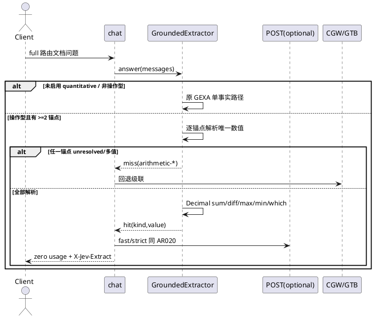
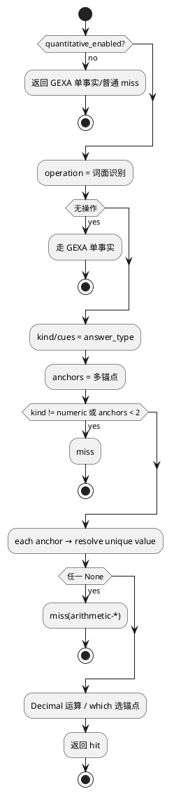

# [AR021] 详细设计说明书

# 1 AR概述

| 组件名称 | Jev 文档数值推理快路径 |
| --- | --- |
| AR 系统流水号 | AR021 |
| AR 描述 | GQRA：多锚点接地数值的确定性 sum/diff/max/min/which 运算，命中零 LLM |

# 2 动态行为



# 3 功能点分解

| 序号 | 功能点 | 描述 | 需求 |
| --- | --- | --- | --- |
| 1 | 配置 | `quantitative_enabled` 默认关 | FR21-1 |
| 2 | 数据集 | numeric_reasoning 12 题 | FR21-5 |
| 3 | 多锚点解析 | 复用 GEXA 线索/span/唯一性 | FR21-2 |
| 4 | 运算 | sum/diff/max/min/which | FR21-3 |
| 5 | 组合 | 零 usage、POST、回退 | FR21-4 |

# 4 实现设计

## 4.1 思路

GEXA 已能对“单锚点+线索”解析唯一值。GQRA 把“解析一个值”扩展为
“解析每个锚点的值”，再用问题中的操作词选择确定性运算。操作词未识别或
任一锚点不唯一，则整体 miss，绝不返回部分结果。

## 4.2 流程图



## 4.3 接口

```python
@dataclass(frozen=True)
class ExtractiveConfig:
    enabled: bool = False
    min_document_chars: int = 200
    max_answer_chars: int = 64
    max_anchor_occurrences: int = 64
    quantitative_enabled: bool = False   # AR021

class GroundedExtractor:
    def answer(self, messages) -> ExtractionResult: ...
    def _arithmetic(self, document, question, lowered) -> ExtractionResult | None: ...
    def _resolve_anchor(self, document, anchor, cues) -> str | None: ...
```

`ExtractionResult.kind` 扩展：`numeric-sum/diff/max/min`、`id-max/id-min`。

## 4.4 代码设计

```text
src/jev/kernel/extract/grounded.py       GQRA 运算与多锚点解析
src/jev/bench/numeric_reasoning.py       真实确定性数据集
src/jev/bench/matrix.py                  dataset=numeric_reasoning
kernel/kernel.py / bench/matrix.py       quantitative_enabled 配置
src/jev/server/chat.py                   复用 AR020 快路径分支
tests/unit/test_grounded_extractor.py
tests/unit/test_quantitative_reasoning.py
tests/integration/test_extractive_real.py
configs/experiments/quantitative.toml
configs/experiments/quantitative-needles.toml?（可选回归）
```

# 5 重构设计

无新路由分支；`GroundedExtractor.answer` 内先尝试操作型，再回落原单事实，
因此 AR020 行为在 `quantitative_enabled=false` 时不变。

# 6 测试设计

## 6.1 单元测试

- numeric_reasoning 12/12 正确；原 GEXA 关闭时仍 miss；
- sum/diff/max/min/which_max/which_min 各至少 1 例；
- 单锚点/操作不支持/锚点歧义/锚点自身数字 -> miss；
- Decimal 整数格式；关闭 quantitative 与 AR020 一致。

## 6.2 接口测试

- chat 命中 zero usage + `X-Jev-Extract: hit:numeric-sum|id-max`；
- fast/strict POST 复用；拒绝/异常回退。

## 6.3 业务场景

- 真实矩阵 B1/CGW/GEXA/GQRA；
- GEXA 的 shared/needles/quality 回归不降。

## 6.4 异常场景

- 任一锚点 unresolved -> miss；
- 非法操作/字段 -> miss；
- 抽取异常 -> AR020 捕获回退。
