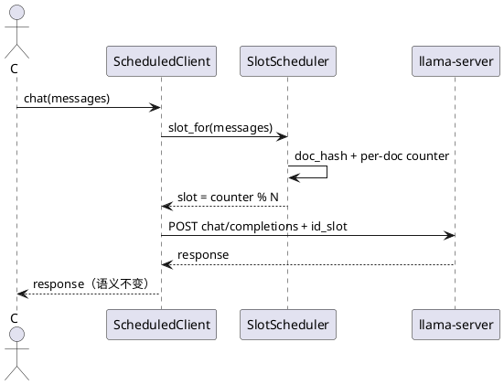
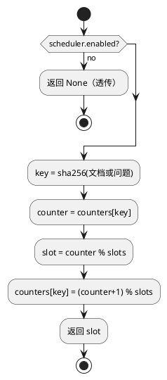

# [AR022] 详细设计说明书

# 1 AR概述

| 组件名称 | Jev 大脑并行槽调度 |
| --- | --- |
| AR 系统流水号 | AR022 |
| AR 描述 | PSS：parallel=N + per-document id_slot 轮转，提高 GPU 并发吞吐 |

# 2 动态行为



# 3 功能点分解

| 序号 | 功能点 | 描述 | 需求 |
| --- | --- | --- | --- |
| 1 | 配置 | parallel/scheduler/互斥 | FR22-1 |
| 2 | 调度器 | 文档 hash + 轮转 | FR22-2 |
| 3 | 客户端 | chat/stream 注入 id_slot | FR22-3 |
| 4 | 实验 | 真实并发脚本 | FR22-4 |
| 5 | 组合 | GEXA/GQRA/PPKS 边界 | FR22-5 |

# 4 实现设计

## 4.1 思路

`parallel=N` 让 llama-server 维护 N 个 KV 槽。对同一文档的请求，按文档独立
计数器轮转槽位：连续请求分散到不同槽以并行解码，同时每个槽在首次请求后各自
持有该文档前缀 KV，后续请求可复用。不同文档互不共享计数器。

## 4.2 流程图



## 4.3 接口

```python
@dataclass(frozen=True)
class SlotSchedulerConfig:
    enabled: bool = False
    slots: int = 1

class SlotScheduler:
    @property
    def enabled(self) -> bool: ...
    def slot_for(self, messages) -> int | None: ...

class ScheduledClient:
    def __init__(self, inner: LlamaServerClient,
                 scheduler: SlotScheduler) -> None: ...
    def chat(...) -> dict: ...
    def chat_stream(...) -> Iterator[dict]: ...
```

`LlamaServerManager` 由现有 `slot_server_args(parallel=...)` / matrix
`--parallel` 启动；`ScheduledClient` 通过 `extra_body["id_slot"]` 指定槽。

## 4.4 代码设计

```text
src/jev/kernel/cerebrum/scheduling.py   配置/调度器/客户端
src/jev/kernel/kernel.py                [cerebrum] 配置 + 互斥
src/jev/server/app.py                   包装 large brain client
src/jev/bench/matrix.py                 parallel/scheduler 接线
scripts/bench_concurrency.py            真实并发对照
configs/profiles/latency-best-gpu-{throughput,affinity}.toml
tests/unit/test_slot_scheduler.py
tests/integration/test_slot_scheduler_real.py
```

# 5 重构设计

无路由改动；默认 `parallel=1 + scheduler off` 时 `ScheduledClient` 不注入，
单请求路径与 AR021 完全一致。

# 6 测试设计

## 6.1 单元测试

- 关闭/开启、轮转、不同文档独立、问题变化保持文档 lane；
- chat/stream extra_body 注入且保留原字段；
- 配置非法/parallel 保护/与快照互斥。

## 6.2 接口测试

- 真实 parallel=2，两次请求后 slots 端点显示两个槽均有 prompt；
- 响应内容/usage 语义正常。

## 6.3 业务场景

- 真实并发 12 题×4 客户端，parallel1/2/4 auto/scheduled；
- 质量 12/12，吞吐与 P50 记录在 results.json。

## 6.4 异常场景

- parallel<2 且 scheduler=true → `JevProtocolError`；
- 快照与调度同时启用 → `JevProtocolError`；
- 调度关闭 → 透传，无 id_slot。
