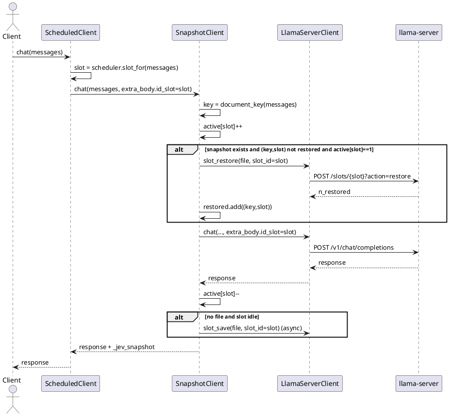

# 1 AR概述

| 组件名称 | Jev 大脑多槽持久化前缀 |
| --- | --- |
| AR系统流水号 | AR023 |
| AR描述 | MSPP：把 AR019 KV 快照与 AR022 并行槽/文档亲和组合，按请求 `id_slot` 恢复/保存，实现冷启动 + 并发同时受益 |

# 2 动态行为



# 3 功能点分解

| 序号 | 功能点 | 描述 | 需求 |
| --- | --- | --- | --- |
| 1 | 请求槽解析 | 从 extra_body.id_slot 或配置取槽 | FR23-1 |
| 2 | 每槽恢复状态 | `(key,slot)` 集合，独立恢复 | FR23-2 |
| 3 | 并发安全 | 槽在途计数，忙则跳过 restore/save | FR23-3 |
| 4 | 配置兼容 | 移除互斥，单槽行为不变 | FR23-4 |
| 5 | 真实组合实验 | 冷重启 + 并发 4 对照 | FR23-5 |

# 4 实现设计

## 4.1 功能实现思路

快照文件表示的是“文档前缀 KV”，本身与 slot 无关。AR019 把它固定恢复/保存到 slot 0；
MSPP 改为使用本次请求实际分配的 `id_slot`。外层 `ScheduledClient` 先决定槽并写入
`extra_body.id_slot`，内层 `SnapshotClient` 读取该值，调用
`/slots/{slot}?action=restore|save`。这样同一份文件可以被多个槽复用，同时保留
AR022 的并发/文档亲和能力。

并发安全采用**槽在途计数**：恢复只在该槽无其它在途请求时进行；保存只在该槽空闲时异步
发起。恢复失败在多槽模式下不删除文件（可能只是该槽暂不可用），回退正常 prefill。

## 4.2 流程说明

1. `ScheduledClient` 计算文档 hash 并轮转得到 slot，写入 `extra_body["id_slot"]`；
2. `SnapshotClient` 计算文档 key，取真实 slot；
3. 若 `(key,slot)` 未恢复且该槽空闲且文件存在 → `slot_restore`；
4. 调用大脑请求（携带 id_slot），槽内 KV 命中；
5. 请求结束后，若文件不存在且该槽空闲 → 异步 `slot_save`；
6. 保存/恢复都失败时只记录，正常 prefill 兜底。

## 4.3 接口描述

```python
@dataclass(frozen=True)
class SnapshotConfig:
    enabled: bool = False
    directory: Path | None = None
    max_entries: int = 4
    min_chars: int = 1000
    slot_id: int = 0
    per_request_slot: bool = False   # 新增：按 extra_body.id_slot 工作

class SnapshotClient:
    def chat(..., extra_body: dict | None = None) -> dict: ...
    def chat_stream(...) -> Iterator[dict]: ...  # 流式仍不启用快照
```

`LlamaServerClient.slot_save/slot_restore` 已支持 `slot_id`，无需改协议。

## 4.4 代码设计

```text
src/jev/kernel/cerebrum/snapshot.py    SnapshotConfig.per_request_slot
                                       SnapshotClient active/restored per slot
src/jev/kernel/kernel.py               _build_snapshot_config 不再要求 parallel=1
                                       移除 snapshot + scheduler 互斥
src/jev/server/app.py                  保持 SnapshotClient 内层、ScheduledClient 外层
src/jev/bench/matrix.py                _snapshot_config 传入 per_request_slot
                                       移除 snapshot/scheduler 互斥
scripts/bench_multislot_snapshot.py    真实冷重启并发对照
configs/experiments/ar023-mspp.toml    真实矩阵配置
configs/profiles/latency-best-gpu-mspp.toml  生产档
tests/unit/test_snapshot_multislot.py
tests/integration/test_multislot_snapshot_real.py
```

# 5 重构设计

- AR019 默认路径不变：`per_request_slot=false`、`slot_id` 配置值生效；
- AR022 默认路径不变：scheduler 关闭时无 id_slot 注入；
- 仅当 snapshot + scheduler 同时启用时进入多槽路径；
- 旧的“互斥 fail-fast”测试改为“组合可用”测试。

# 6 测试设计

## 6.1 单元测试

- 无 id_slot 时使用配置 slot；有 id_slot 时优先；
- 同一 key 在 slot 0 恢复后，slot 1 仍会调用 restore；
- 槽忙时跳过 restore/save；
- 单槽恢复失败删除文件；多槽恢复失败不删除；
- 配置默认关闭；LRU 上限；extra_body 原样传递。

## 6.2 接口测试

- 真实 parallel=2/4 + scheduler + MSPP：两个/四个槽均能 restore；
- `X-Jev-KV-Snapshot` / `_jev_snapshot` 状态正确；
- response usage/内容与无快照一致。

## 6.3 业务场景测试

- shared-prefix 12 题，并发 4，冷启动第一轮 + 稳态第二轮；
- 对比 parallel1、parallel4 auto、parallel4 scheduler、parallel4 MSPP；
- 质量金标 12/12，无错误答案。

## 6.4 异常场景测试

- 快照文件不存在 → 正常 prefill；
- 恢复失败 → 回退，不 5xx；
- 槽忙 → 跳过 restore，正常 prefill；
- 快照目录不可写 → 启动 fail-fast（沿用 AR019）。
