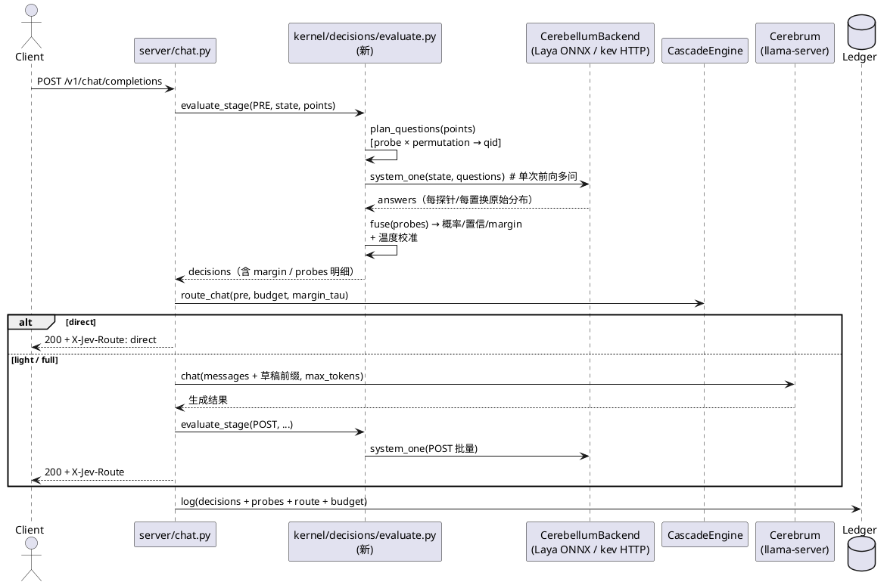
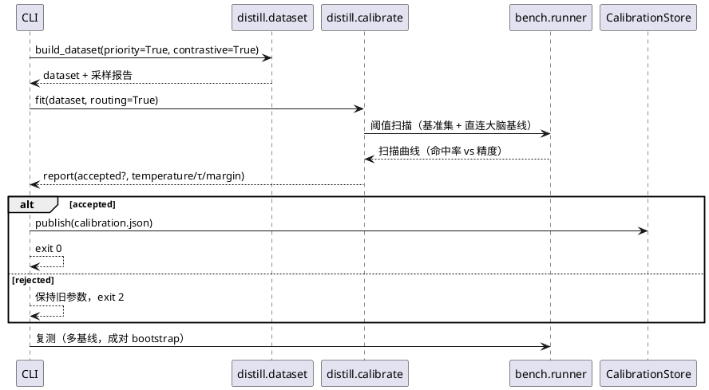
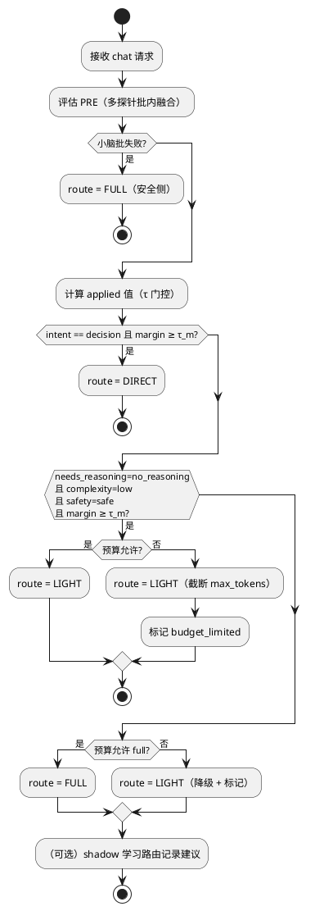

# 1 AR概述

| 组件名称 | Jev 端侧快慢双系统运行时（Kernel + 薄壳） |
| --- | --- |
| AR系统流水号 | AR002 |
| AR描述 | 在 AR001 可运行骨架上做**判定质量工程与智能路由**的架构级创新：多探针并行决策 + 顺序不变性 + 路由专用校准 + margin/预算路由 + 草稿注入 + 学习式 shadow 路由 + 蒸馏飞轮闭环 + 多基线评测 + 复现工程。目标是让级联命中率从 ST 实测 0% 提升到 ≥60%（CI 显著优于基线），并以多基线量化证明双系统收益；全部后端真实、零 mock。 |

**设计驱动因素（来自 srs.md）**

| 类别 | 内容 |
| --- | --- |
| 功能点 | FR1 判定质量（多探针/置换/校准）、FR2 智能路由（margin/预算/草稿/超时/shadow 学习）、FR3 飞轮（难例/对比样本/一键闭环）、FR4 评测（多基线/CI/指纹）、FR5 复现工程 |
| 性能 | PRE 增量 ≤150ms；直答 P50 ≤ 大脑 P50×1/3；brain token 降 ≥40% |
| 质量 | 命中率 ≥60%（CI 下限 > 0% 基线）；精度保持 ≥-2pt；flip rate 降 ≥50% |
| 接口约束 | `/v1/systemone`、`/v1/chat/completions` 只增不改；`Kernel`/`CascadeEngine` 公共方法签名向后兼容 |
| 架构约束 | 薄壳 → kernel → 子模块；纯逻辑与后端可测；配置单源 |
| 技术栈 | Python 3.11 / uv / onnxruntime / httpx / numpy（不新增重依赖） |

**核心洞察（设计依据）**

1. `evaluate_decisions`（server/chat.py:165）已把同 stage 所有点合并为**一次** systemone 前向——探针与置换可以零额外往返扩展为「同一次前向内多问」，这是本项目相对其它级联方案的结构性优势（laya 单次编码多问）。
2. 命中率 0% 的根因是「单问法 + 单顺序 + 固定 τ」：score 型 complexity 恒 medium、intent 无 decision 输出。多问法（带 criteria 的 choice / 正反 Noul / 成对比较）+ 置换平均 + 校准后阈值，可在**不改资产**的前提下恢复可分辨性。
3. 学习式路由与预算控制必须默认关闭、shadow 先行（hermes/DuoMind 经验），避免无证据切换。

# 2 动态行为

## 2.1 带探针融合的 chat 请求（PRE → 路由 → 生成）



## 2.2 蒸馏飞轮闭环（`jev distill --flywheel`）



# 3 功能点分解

| 序号 | 功能点名称 | 模块落点 | 功能点描述 |
| --- | --- | --- | --- |
| 1 | 多探针声明与规划 | `kernel/decisions/probes.py`（新） | 决策点声明 K 种探针；生成 qid 计划（probe×perm） |
| 2 | 置换平均 | `kernel/decisions/probes.py` | choice 选项按种子置换 N 次，按选项名归并 |
| 3 | 探针融合 | `kernel/decisions/probes.py` | 对数意见池加权融合 + margin 计算 |
| 4 | 批量评估（重构） | `kernel/decisions/evaluate.py`（新，自 server 迁入） | 单次前向多问；逐点融合；异常安全侧 |
| 5 | 路由校准 | `distill/calibrate.py` 扩展 | per-point 温度 + τ/margin 扫描（精度约束下最大化命中率） |
| 6 | margin 升级路由 | `kernel/cascade/engine.py` | margin < τ_m → FULL；默认关闭 |
| 7 | 代价预算 | `kernel/cascade/budget.py`（新）+ engine | 请求级 token/延迟预算约束升级 |
| 8 | 草稿注入/历史压缩 | `server/chat.py` + `kernel/cascade/draft.py`（新） | PRE 结构化前缀 + 多轮历史压缩 |
| 9 | 超时预算统一 | `kernel/cerebrum/llama_server.py` + chat | HTTP 超时 < 级联 deadline，超时走降级 |
| 10 | 学习式 shadow 路由 | `kernel/cascade/learned.py`（新） | numpy 逻辑回归；shadow 记录建议 |
| 11 | 难例采样/对比样本 | `distill/dataset.py` | 优先级采样；偏好对产出 |
| 12 | 飞轮 CLI | `cli/main.py` + `distill/flywheel.py`（新） | 一键闭环 + 门退出码 |
| 13 | 多基线 bench | `bench/runner.py` + `bench/metrics.py` | 三基线统一指标 |
| 14 | 显著性与指纹 | `bench/metrics.py` + `bench/report.py` | 成对 bootstrap CI + 环境指纹 |
| 15 | 双语基准集 v2 | `configs/bench-set.yaml` | 中英各半 + 多轮子集 + 校验 |
| 16 | 复现文档与实验矩阵 | `README.md`/`docs/REPRODUCTION.md`/`configs/experiments/` | 双路径复现 |
| 17 | 脚本与推送方法论 | `scripts/`、`tools/`、`docs/GITEE_SYNC_METHODOLOGY.md` | 一键实验/CI/最小包工具 |

# 4 实现设计

## 4.1 功能实现思路（方案选择）

### 方案 A：批内多探针 + 置换平均 + 路由校准（推荐）

**思路：** 在既有「单次前向多问」能力上，把每个决策点扩展为 K 个异构探针 × N 个选项置换，作为同一批问题一次性评估；按温度校准后的权重做对数意见池（log-opinion pool）融合，输出分布/置信度/margin；路由阈值与 margin 由基准集扫描拟合。

**优点：** 不加后端往返（延迟几乎不变）；顺序偏差被平均消除；异构问法互补（von 明确 Noul 无 criteria 最弱 → 用带正反描述的 criteria）；可解释（每探针分布入台账）；无需重训资产；与 kev 后端同样适用（kev 也是 prefill-only 多问）。
**缺点：** 前向 token 略有增加（K×N 个问题分支）；需要校准样本。
**对 NFR：** PRE 增量主要来自分支编码，实测目标 ≤150ms；命中率与 flip rate 直接改善。

### 方案 B：仅调阈值/温度（最小改动）

**思路：** 保留单探针，重新拟合 τ 与温度。
**优点：** 改动最小。
**缺点：** AR001 探针数据表明 complexity 恒 medium、intent 无 decision —— 阈值无法凭空造出区分度；预估上限 ~65% 且不稳定（full-01 误判 0.89）。**不满足**命中率 ≥60% 的 Must 门（CI 需显著）。
**结论：** 不推荐，仅作为 A 的兜底（A 分阶段门 40% 时的过渡）。

### 方案 C：重训小脑（换底座/新增中文模型）

**思路：** 以 kev 0.8B LoRA 或新数据重训小脑达到判定质量。
**优点：** 上限最高。
**缺点：** 本机无 CUDA torch（内网镜像仅 Linux 轮），训练成本高；资产形态变更超出「可复现端侧」定位；无法在本 AR 周期内验证。
**结论：** 列后续 AR（本 AR 提供飞轮与配置，使该路径可在 GPU 服务器直接执行）。

**推荐：方案 A**（并以 B 作为降级、C 作为后续）。

## 4.2 功能实现设计

### 4.2.1 路由决策流程图



### 4.2.2 流程说明

1. **问题规划**：`plan_questions(points, seed)` 为每个 decision point 生成问题集合：
   - 探针：`probe[0]` 为点自身定义（向后兼容单探针）；`probe[1..]` 来自点配置（异构问法）。
   - 置换：choice 型按 `permutations` 生成 N 个选项顺序变体（`random.Random(seed+point)` 决定，保证可复现）。
   - qid 命名：`{point_id}~{probe_name}~{perm_index}`；点自身探针保持 `{point_id}`（兼容既有测试/台账）。
2. **单次前向**：沿用 `system_one(state, questions)`；laya/kev 均单次编码多问。
3. **归并与融合**：置换变体按选项名归并（消除位置偏差）→ 探针间按 `exp(Σ w_k log p_k)` 融合（概率下限 1e-9 防 log0）；`confidence = max(p)`；`margin = p1 - p2`。
4. **温度校准**：融合前对每个探针分布应用 `p^(1/T_point)` 归一（per-point 温度，来自校准文件；缺失则 T=1）。
5. **路由**：`CascadeEngine.route_chat(pre, *, margin_tau=0.0, budget=None)`；margin 与预算默认关闭（向后兼容）。预算由 `BudgetGuard` 估算：`estimated_brain_tokens = f(state_tokens, route)`；超限时按图示降级。
6. **草稿注入/压缩**：路径②③构造大脑 messages：`[system: 小脑预判摘要] + compressed_history + 当前轮`；多轮历史保留最近 `keep_turns`，更早轮次替换为决策摘要（含 intent/complexity/关键约束），并记录 `prompt_tokens` 前后差异。
7. **超时预算**：`LlamaServerClient(timeout_s=min(generation_deadline - buffer, config.brain_http_timeout_s))`；`httpx.TimeoutException` → 按「生成超时」走截断+POST 复核降级（不返回 503）。
8. **学习式 shadow**：`LearnedRouter` 从台账聚合特征向量，加载（或离线训练）逻辑回归权重；请求时输出建议 `direct/light/full` 与置信，写台账 `shadow_route`，不改变控制流。
9. **飞轮**：`run_flywheel()` 编排 采集→数据集（含难例/对比）→校准（含路由扫描）→发布/拒绝→复测报告。
10. **多基线 bench**：`run_bench(..., baselines=[...])` 三条基线共用同一把尺子（POST 复核 + 基准集标签）。

### 4.3 接口描述

#### 4.3.1 新增/变更的内部接口（kernel 契约）

```python
# kernel/decisions/probes.py（新）
@dataclass(frozen=True)
class ProbeSpec:
    name: str                      # 探针名（台账/校准键）
    question_type: str             # choice | noul | score
    question: str                  # 问法模板
    options: tuple[str, ...] = ()  # choice/score 的语义选项（与点 options 对齐）
    weight: float = 1.0            # 融合权重

@dataclass(frozen=True)
class ProbePlan:
    point_id: str
    questions: dict[str, Question]      # qid -> Question（本点全部探针×置换）
    permuted: dict[str, list[str]]      # qid -> 置换后的选项顺序（归并用）

def plan_questions(points, *, seed: int = 0) -> tuple[dict[str, Question], list[ProbePlan]]

@dataclass(frozen=True)
class FusedPoint:
    point_id: str
    distribution: dict[str, float]  # 语义选项 -> 融合概率
    confidence: float               # max(p)
    margin: float                   # p1 - p2
    probes: dict[str, dict[str, float]]  # 每探针归并后分布（台账用）

def fuse_point(plan: ProbePlan, answers: dict[str, Answer],
               calibration: Mapping[str, PointCalibration] | None) -> FusedPoint
```

```python
# kernel/decisions/evaluate.py（新，自 server/chat.py 迁入并增强）
def evaluate_stage(cerebellum, points, state, *, seed=0,
                   calibration=None) -> StageEvaluation
@dataclass(frozen=True)
class StageEvaluation:
    decisions: list[Decision]           # Decision 新增 margin/probes 字段
    answers: dict[str, Answer]          # 兼容既有调用方
    latency_ms: float
    fused: dict[str, FusedPoint]

# server/chat.py 保留 shim：evaluate_decisions(...) 委托 evaluate_stage（弃用告警）
```

```python
# kernel/decisions/framework.py（扩展，向后兼容）
@dataclass(frozen=True)
class DecisionPoint:
    ...                                  # 既有字段不变
    probes: tuple[ProbeSpec, ...] = ()   # 空 = 单探针（既有行为）
    permutations: int = 1                # 1 = 不置换

@dataclass
class Decision:
    ...                                  # 既有字段不变
    margin: float | None = None
    probes: dict[str, dict[str, float]] | None = None
```

```python
# kernel/cascade/engine.py（扩展；AR002 落地含能力门控，见 §4.5.1）
def route_chat(self, pre, *, margin_tau: float = 0.0,
               budget: BudgetContext | None = None) -> Route

@dataclass(frozen=True)
class RoutePolicy:
    capability_gate: bool = True              # false 恢复 AR001 判定
    light_requires_low_complexity: bool = False
```

# kernel/cascade/budget.py（新）
@dataclass(frozen=True)
class BudgetContext:
    max_brain_tokens: int | None = None
    max_latency_ms: float | None = None
    state_tokens: int = 0

def estimate_brain_tokens(state_tokens: int) -> int
def allows_full(budget: BudgetContext | None, route: Route) -> bool
```

```python
# kernel/cascade/learned.py（新）
@dataclass(frozen=True)
class LearnedRouter:
    weights: tuple[float, ...]
    bias: float
    feature_names: tuple[str, ...]
    def suggest(self, features: Mapping[str, float]) -> tuple[str, float]  # (route, confidence)
def extract_features(pre, state_len: int) -> dict[str, float]
def train_logreg(rows, labels, *, l2: float = 1e-2, epochs: int = 400) -> LearnedRouter
```

```python
# distill/calibrate.py 扩展 + 新校准 schema v2
{"schema": 2,
 "global": {"temperature": {"choice": 1.2, ...}, "accepted": true},
 "points": {"intent": {"temperature": 1.31, "tau": 0.55, "margin": 0.18}, ...},
 "routing": {"scan": [...], "selected": {"hit_rate": .., "delta_pt": ..},
             "baseline": {"brain_direct_delta_pt": ..}}}
```

#### 4.3.2 CLI / 配置

| 入口 | 变更 |
| --- | --- |
| `jev distill --calibrate` | 新增 `--routing`（路由阈值扫描）、`--priority`（难例采样）、`--contrastive` |
| `jev distill --flywheel` | 新：一键闭环；exit 0 发布 / 2 拒绝 / 1 失败 |
| `jev bench --baselines all` | 新：三条基线；`--seed`、`--report-dir` |
| `jev bench --calibrate-routing` | 新：内部调用阈值扫描（等价 distill --calibrate --routing 的采集口径） |
| `configs/decision-points.toml` | 每点可增 `[[point.probe]]` 子表与 `permutations` |
| `configs/jev.toml` | `[probes] enabled/seed`；`[cascade] margin_tau/max_brain_tokens/max_latency_ms/keep_turns`；`[cerebrum] http_timeout_s`；`[learned_router] enabled/model_path` |
| `configs/bench-set.yaml` | v2：中英各半 + `lang`/`turns` 标签 + 多轮子集 |

#### 4.3.3 对外协议（只增不改）

- `/v1/chat/completions` 响应头新增 `X-Jev-Margin`、`X-Jev-Budget`（可选）；响应体不变。
- `/v1/systemone` 不变。

### 4.4 代码设计

```
src/jev/
├── kernel/
│   ├── decisions/
│   │   ├── framework.py      # DecisionPoint/Decision 扩展（probes/permutations/margin）
│   │   ├── probes.py         # 【新】探针规划/置换/融合
│   │   └── evaluate.py       # 【新】stage 批量评估（自 server 迁入）+ 校准注入
│   ├── cascade/
│   │   ├── engine.py         # margin 路由 + 预算参数
│   │   ├── budget.py         # 【新】预算估算与判定
│   │   ├── draft.py          # 【新】PRE 草稿前缀 + 多轮历史压缩
│   │   └── learned.py        # 【新】逻辑回归 shadow 路由
│   └── cerebellum/
│       └── registry.py       # 校准 v2 加载（per-point 温度/τ/margin）
├── server/chat.py            # 改用 evaluate_stage；草稿注入；超时分类；台账字段
├── distill/
│   ├── dataset.py            # 难例优先采样 + 对比样本
│   ├── calibrate.py          # 路由扫描 + schema v2
│   └── flywheel.py           # 【新】闭环编排
├── bench/
│   ├── runner.py             # 多基线 + 种子 + 基线无关的度量
│   ├── metrics.py            # bootstrap CI、order_flip_rate、相对收益
│   └── report.py             # 对比汇总 + 环境指纹
└── cli/main.py               # 新参数（--routing/--priority/--contrastive/--flywheel/--baselines）

docs/REPRODUCTION.md          # 【新】
docs/GITEE_SYNC_METHODOLOGY.md# 【新】（脱敏）
configs/experiments/*.yaml    # 【新】实验矩阵
scripts/run_experiment.sh|ps1 # 【新】
tools/push_min_pack.py        # 【新】最小包直推
```

**依赖方向**：`server/bench/cli → kernel → cerebellum/cerebrum`；`kernel/decisions/evaluate.py` 不依赖 server（消除 bench→server 反向依赖，AR001 遗留观察项）。

## 4.5 关键算法与参数

| 项 | 取值/公式 | 说明 |
| --- | --- | --- |
| 融合 | `p ∝ exp(Σ_k w_k · log p_k)`，`p_k` 先做 `^(1/T_k)` | 对数意见池；等价几何平均的归一 |
| 归并 | 置换变体按**选项名**累加再平均 | 顺序不变性来源 |
| 置信 | `max(p)`（choice/score）；Noul 取 `max(p_true, 1-p_true)` | 与既有 confidence 公式单调一致 |
| margin | `p_top1 - p_top2` | 仅 choice/score；Noul 用 `abs(p-0.5)*2` 的等价 margin |
| τ/margin 选择 | 在 `delta_pt ≥ -2` 约束下最大化基准集命中率 | 网格扫描；记录全曲线 |
| 预算估算 | `tokens ≈ ceil(state_tokens * 1.1) + max_tokens` | 保守估计；实际以 usage 回填校准 |
| 逻辑回归 | `σ(w·x + b)`，L2=1e-2，全批量 GD 400 轮，标准化特征 | 纯 numpy，可复现（固定初始化 0） |
| 历史压缩 | 保留最近 `keep_turns=2` 轮原文；更早轮次→决策摘要（≤120 字/轮） | 多轮场景 token 降幅门 |
| 单次 HTTP 超时 | `timeout_s = max(0.001, deadline - now)`；无 deadline 用客户端默认 | FR2-4：消除 120s 客户端超时与级联 deadline 竞态（每个分段/重试独立推导） |
| 成对 bootstrap CI | 差值重采样 2000 次，固定种子 `20261025`，取 2.5%/97.5% 分位 | FR4-2：可复现；`paired_deltas` 仅统计双端可复核样本 |
| 环境指纹 | python/onnxruntime/httpx/numpy/yaml 版本 + platform/machine + 资产 SHA-256 | FR4-2：报告可追溯；哈希流式计算不占内存 |

### 4.5.1 路由口径修订（真实资产实测驱动，T001/T002 落地）

**问题**：AR001 口径下 direct 仅认 `intent==decision`、light 需 `complexity==low`。真实 Laya 权重实测（20 题分层集）：
`intent` 探针在决策类问题上稳定输出 `simple/complex`，`decision` 几乎不出现 → 命中率 0%；
`complexity` 置信度抖动（0.43–0.86）且与难度标签弱相关。

**实测对照**（同一批决策输出，仅换路由规则）：

| 规则 | 命中率（direct+light） | 精确匹配 | 误降级（full→light/direct） |
| --- | --- | --- | --- |
| AR001 原规则 | 10.0% | 30.0% | 0 |
| 仅加 `needs_generation` → direct | 75.0% | 45.0% | 5 |
| **能力门控（采纳）** | **75.0%** | **45.0%** | **3** |

**采纳规则**（`RoutePolicy.capability_gate=True`，`configs/jev.toml [cascade]`）：

1. 任一 ACTIVE 决策 `from_fallback` → full；
2. `margin_tau>0` 且任一点 margin 不足 → full；
3. `safety` 显式 `unsafe` → full（安全点缺失不阻断最小装配）；
4. `intent==decision` **或**（`needs_generation==no_generation` ∧ `needs_reasoning==no_reasoning` ∧ `complexity==low`）→ direct；
5. `needs_reasoning==no_reasoning` → light（不再强制 `complexity==low`；可用 `light_requires_low_complexity=true` 恢复）；
6. 预算不足 → light；否则 full。

**依据与边界**：多探针+置换使 `complexity` 首次产生三档区分（AR001 恒 medium），但复杂度门仍不稳，故降级为可选门；
`needs_generation` 是唯一对决策类稳定的正交信号（10/10 `no_generation`），但单独使用会把推理题误降（5 例），
故与 `needs_reasoning`/`complexity` 合取。剩余 3 例误降级由 T007 shadow 学习路由 + T009 飞轮校准继续收敛。
本修订不改变线协议与默认关闭项（margin/预算/草稿注入）。


# 5 重构设计

| 重构项 | 现状 | 目标 | 理由 |
| --- | --- | --- | --- |
| 决策评估归属 | `server/chat.py::evaluate_decisions`（bench 反向 import） | 迁入 `kernel/decisions/evaluate.py`，server 保留兼容 shim | 依赖方向（C2）；bench 与 server 共用单一实现 |
| 校准加载 | `cerebellum/registry.py::_load_calibration` 只认全局温度 | 兼容 v1，新增 v2（per-point + 路由） | 不破坏既有校准文件 |
| bench 度量 | 单基线 | 多基线 + CI + 指纹 | FR4；同尺子可复核 |

**兼容性**：既有 427 单测全绿；`evaluate_decisions` shim 保留；探针=1、置换=1、margin_tau=0、预算=None、草稿注入关闭时，
除 §4.5.1 的能力门控外与 AR001 一致——能力门控是 AR002 的**有意行为变更**（实测 10%→75% 命中率），
可用 `[cascade] capability_gate=false` 逐字恢复 AR001 判定；UT-route 同时覆盖两种口径。

# 6 测试设计

## 6.1 单元测试（UT）

| 用例组 | 覆盖 | 关键断言 |
| --- | --- | --- |
| UT-probes-plan | 探针/置换规划、qid 命名、种子复现 | 同种子逐位一致；置换覆盖全排列子集；点自身探针保持原 qid |
| UT-probes-fuse | 归并/融合/置信/margin | 同分布置换合并后不变；权重偏向生效；log(0) 防护 |
| UT-evaluate | 批量评估、异常安全侧、校准注入 | 单次 system_one 调用；缺失答案回退；温度改变置信 |
| UT-route | margin 路由、预算降级、默认关闭 | 默认行为与 AR001 逐例一致（回归） |
| UT-draft | 草稿前缀、历史压缩 | 保留最近 N 轮；摘要长度上限；token 计数 |
| UT-timeout | HTTP 超时分类 | ReadTimeout → 降级路径；连接拒绝 → 不可用 |
| UT-learned | 逻辑回归训练/推理/特征 | 可分数据 100% 准确；权重可复现；空模型报错 |
| UT-dataset | 难例采样、对比配对 | 难例占比提升；配对合法（同点同 state） |
| UT-calibrate-v2 | 路由扫描、schema v2、v1 兼容 | 扫描选中点在约束内；v1 文件仍可加载 |
| UT-bench | 三基线、CI、flip rate、指纹 | 同种子可复现；CI 覆盖真值；指纹字段齐全 |
| UT-flywheel | 编排顺序、门退出码、拒绝保持旧参数 | 空台账非零退出；拒绝不发版 |
| UT-report | 对比表、失败样本清单 | Markdown 结构稳定 |

## 6.2 接口测试

- 既有：`/v1/systemone`、`/v1/chat/completions`、`/health` 全量回归（不得破坏）。
- 新增头：`X-Jev-Margin`、`X-Jev-Budget` 在启用时出现、关闭时缺省。
- CLI：`jev bench --baselines all`、`jev distill --flywheel`、`--help` 参数完整。

## 6.3 业务场景测试（真实资产）

| 编号 | 场景 | 期望 |
| --- | --- | --- |
| BS-Q1 | 双语基准集 bench（多探针+置换+校准） | 命中率 ≥60%，CI 下限 > 0% 基线（AR001 实测 0%） |
| BS-Q2 | 顺序不变性 | `order_flip_rate` 相比单顺序降 ≥50% |
| BS-Q3 | 精度保持 | ≥ 直连大脑 -2pt（成对样本） |
| BS-Q4 | 成本 | 级联 brain tokens 降 ≥40%；full 多轮 prompt 降 ≥15% |
| BS-R1 | 全新克隆复现 | 按 REPRODUCTION.md 跑通 doctor + unit + bench 子集 |
| BS-F1 | 飞轮 | 采集→校准→复测闭环；门结果与退出码一致 |

## 6.4 异常场景测试

| 编号 | 场景 | 期望 |
| --- | --- | --- |
| EX-Q1 | 部分探针缺失/非法 | 点级降级为可用子集；全缺→fallback，安全侧 full |
| EX-Q2 | 置换数超上限/负值 | 配置校验拒绝（明确错误） |
| EX-Q3 | 校准文件 v2 损坏/未知 schema | 拒载 + 诊断；不阻断启动（沿用 AR001：缺失告警降级） |
| EX-Q4 | 大脑慢响应（真实对端延迟 < deadline） | 200（不误 503） |
| EX-Q5 | 预算极小（0 token） | 不升级 full，请求仍 200 且标记 budget_limited |
| EX-Q6 | 台账样本不足训练 shadow 路由 | 明确报错/跳过，不影响主路径 |
| EX-Q7 | 飞轮空台账/样本不足 | 非零退出 + 诊断，不发布 |
| EX-Q8 | bench 中断/基线失败 | 报告标记 partial，退出码非零，不伪造指标 |

## 6.5 srs 追溯矩阵

| srs 需求 | 用例 |
| --- | --- |
| FR1-1 多探针并行 | UT-probes-plan, UT-evaluate, BS-Q1 |
| FR1-2 顺序不变性 | UT-probes-fuse, BS-Q2 |
| FR1-3 路由校准 | UT-calibrate-v2, BS-Q1, BS-Q3 |
| FR2-1 margin 升级 | UT-route, EX-Q1 |
| FR2-2 代价预算 | UT-route, EX-Q5 |
| FR2-3 草稿注入 | UT-draft, BS-Q4 |
| FR2-4 慢响应可靠性 | UT-timeout, EX-Q4 |
| FR2-5 学习 shadow 路由 | UT-learned, EX-Q6 |
| FR3-1 难例采样 | UT-dataset |
| FR3-2 对比样本 | UT-dataset |
| FR3-3 飞轮闭环 | UT-flywheel, BS-F1, EX-Q7 |
| FR4-1 多基线 | UT-bench, BS-Q1 |
| FR4-2 显著性与指纹 | UT-bench |
| FR4-3 报告 | UT-report |
| FR5-1/2 文档与实验矩阵 | BS-R1 |
| FR5-3/4 方法论/CI | 脚本执行 |

# 7 风险与缓解

| 风险 | 影响 | 缓解 |
| --- | --- | --- |
| laya 对异构探针无区分度 | 命中率达不到 60% | 分阶段门（40%→60%）；choice 带 criteria（von 教训）；置换+融合先吃稳定性收益；必要时引入 kev-0.8B 作为探针后端（真实子进程，已验证可用） |
| 多探针 token/延迟上升 | PRE 增量超 150ms | 限制 K×N（默认 3×4 → 12 问）；laya 单次编码多问；bench 实测门 |
| 后端真实调用慢（CPU） | bench 时长 | 子集快速档 + 全量档；慢测试标记 slow |
| 预算/学习路由引入不稳定 | 误降级 | 默认关闭；shadow 先行；回归用例锁定默认行为 |
| 代理推送限制 | 大文件无法上传 | 文档/图片减重；方法论 L1-L4；uv.lock 分片策略已固化 |
| 本机无 CUDA torch | 4B/9B 无法验证 | 交付配置/脚本/预估；0.8B CPU 验证编排正确性 |
