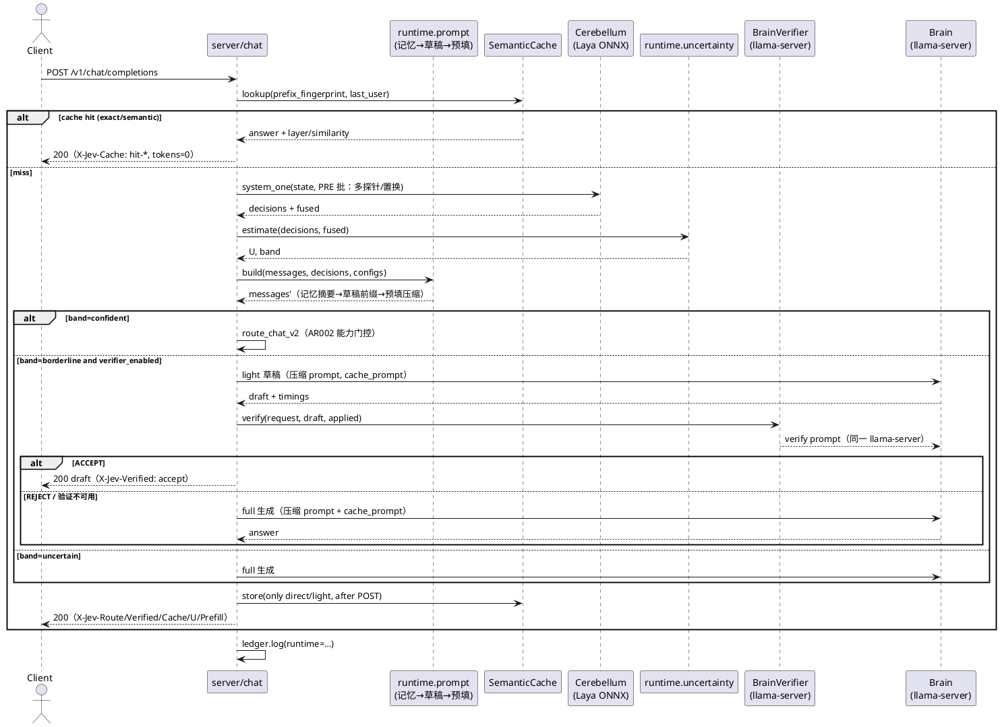
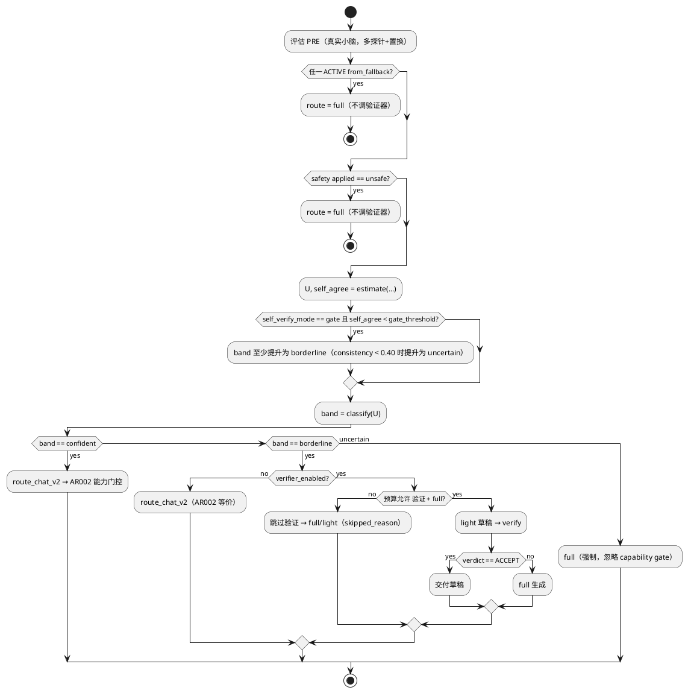
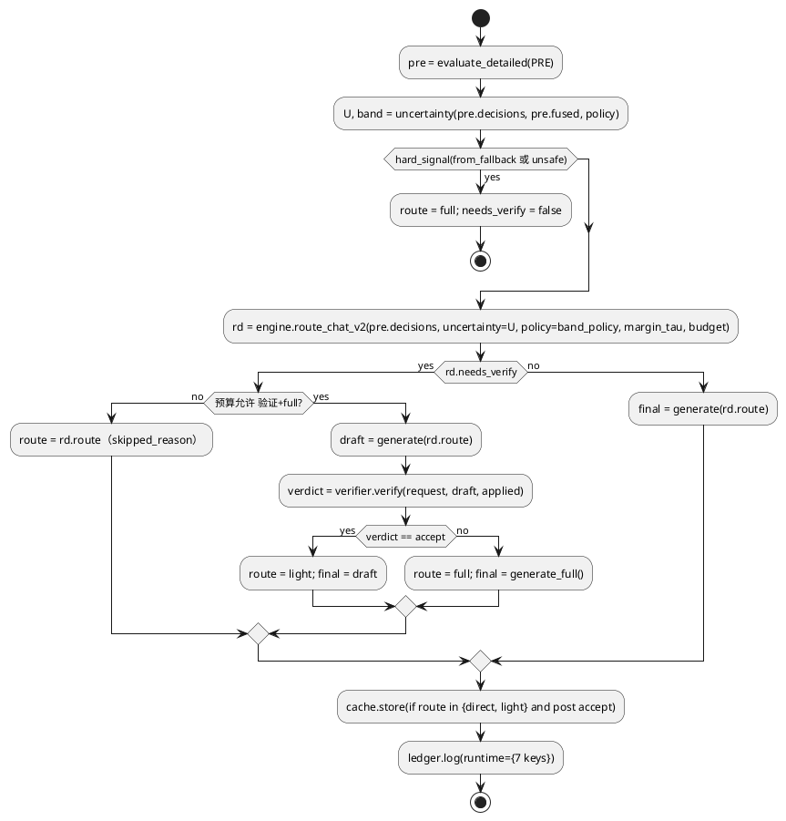

# 1 AR概述

| 组件名称 | Jev 端侧快慢双系统运行时（kernel 运行时智能层） |
| --- | --- |
| AR系统流水号 | AR003 |
| AR描述 | 在 AR002「多探针判定 + 能力门控路由」之上，构建**可验证、可复用、可记忆**的运行时：验证器驱动级联（不确定性三带 + 真实大脑裁决）、前缀/KV 复用、确定性稀疏 prefill 规划、真实 embedding 语义缓存与长程记忆。全部机制在真实 laya ONNX + 真实 llama-server 上验证，无任何 mock。 |

**核心创新（与 SOTA 的对应关系）**

| 创新点 | 思想来源 | 本项目落地差异 |
| --- | --- | --- |
| 不确定性三带 + 真实验证器 | AutoMix（arXiv:2310.12963）、FrugalGPT（arXiv:2305.05176） | 不确定性融合**跨探针置换一致性**（Jev 独有：一次前向多问）与 margin；验证器只在中带触发，受请求预算约束 |
| 计算复用 | llama.cpp prompt cache / slot reuse | 前缀指纹 + `cache_prompt` + `--slot-prompt-similarity`；以响应 `timings.prompt_n` 作为**非伪造**复用证据 |
| 稀疏 prefill 规划 | EdgePrefill（块选择）、MInference/PyramidKV 思想 | Python 侧确定性块显著性（词法+决策信号+位置先验），与 C++ 执行层解耦；质量用真实 40 条 needles 成对验证 |
| 语义缓存 + 长程记忆 | GPTCache 类语义缓存、StreamingLLM 式记忆压缩 | 真实独立 embedding 服务（同 GGUF `--embeddings`），禁用即安全降级；只缓存 direct/light，负例集守门 |
| 学习式 shadow | RouteLLM（arXiv:2406.18665） | 归 AR004：本 AR 提供真实特征与台账，训练与 shadow 报告在 AR004 交付 |

---

# 2 动态行为

## 2.1 请求全链路时序（验证器 + 缓存 + 预填 + 记忆）



## 2.2 三带判定活动图



---

# 3 功能点分解

| 序号 | 功能点 | 描述 | SRS |
| --- | --- | --- | --- |
| 1 | 不确定性量化 | per-point u + 请求级 U（归一化凸组合；缺省项归一；self_agree 缺失置 1） | FR1-1 |
| 2 | 自证信号 | 探针间 top-1 一致性 + 融合一致性；observe/gate 两模式 | FR1-2 |
| 3 | 三带路由 | confident/borderline/uncertain；默认关闭验证器（AR002 回归） | FR1-2 |
| 4 | 大脑验证器 | 真实 verify prompt、严格解析、超时/异常→REJECT、token 计量 | FR1-3 |
| 5 | 预算感知 | 验证与生成共享预算；不足则跳过并记原因 | FR1-4 |
| 6 | 前缀指纹 | 规范化历史 → sha256（64 hex）；缓存键与复用键 | FR2-1 |
| 7 | KV 复用证据 | `cache_prompt` + 响应 `timings.prompt_n`（首选）/`/slots`（补充）；都不可得退化 proxy | FR2-1 |
| 8 | 槽复用配置 | `[cerebrum] parallel`/`slot_prompt_similarity` → 启动参数 | FR2-2 |
| 9 | 复用隔离 | 会话/前缀不匹配强制换前缀；A/B 会话关键词隔离断言 | FR2-3 |
| 10 | 块分割 | 段落/句子/长度上限；首块（system）与末块（当前 user）必选 | FR3-1 |
| 11 | 显著性打分 | 词法重叠 + 决策信号 + 位置先验（确定性、可配权重） | FR3-1 |
| 12 | 预算选择与接入 | 比例预算、短/少块跳过、压缩前后真实 token 记账 | FR3-2 |
| 13 | 质量保持门 | 40 条 needles 成对失败条数不增加 + 二项 CI | FR3-3 |
| 14 | EdgePrefill 协同 | 服务器配置/脚本/文档；本机 schema+命令拼装校验 | FR3-4 |
| 15 | embedding 客户端 | 真实 `/v1/embeddings`，可用性探测，禁用即降级 | FR4-1 |
| 16 | 语义缓存 | 精确+近似（余弦阈值+边际）、LRU/TTL、仅 direct/light、负例集 | FR4-2 |
| 17 | 长程记忆 | 结构化摘要 + 可选检索；10 轮线性增长与早期事实召回 | FR4-3 |
| 18 | 台账与头 | `runtime` 结构化字段（7 键）+ `X-Jev-*`；schema 齐全 | NFR |

---

# 4 实现设计

## 4.1 功能实现思路（方案对比）

### 方案 A：分层「验证-复用-记忆」运行时（推荐）

**思路：** 新增 `kernel/runtime`（不确定性/自证/三带/验证器/prompt 编排）、`kernel/cache`（语义缓存/记忆）、`kernel/prefill`（块选择）三个模块，由 `server/chat.py` 编排；所有能力默认关闭；`CascadeEngine.route_chat` 保持 AR002 语义，新增 `route_chat_v2` 承载三带。

**优点：**
- 每层可独立测量/回滚（消融矩阵天然成立）；
- 纯逻辑模块可 100% 单测；真实后端用例集中在 `tests/integration`（`assets` 标记）；
- 复用真实 llama-server 原生能力（prompt cache、timings、embeddings），无需改 C++；
- 与 AR004（学习路由/飞轮）解耦，可直接消费本 AR 的台账特征与验证/缓存信号。

**缺点：** Python 编排复杂度上升；每个门需要真实实验（耗时）。
**NFR 影响：** 验证器只在中带调用 → 成本可控；复用/压缩直接降 TTFT 与 token。

### 方案 B：学习式单路由替换规则

**思路：** 用台账训练路由分类器，替代全部规则 + 验证器。
**缺点：** 需要足量真实标签（当前 40 题不足）；无验证→精度无保障；无复用/记忆收益；冷启动与漂移风险高。
**结论：** 不推荐作为本 AR 主方案；训练与 shadow 对比归 AR004。

### 方案 C：把 EdgePrefill 稀疏 prefill 直接编入大脑

**思路：** 编译带稀疏 attention/FFN 的 llama.cpp，替换 `llama-server.exe`。
**优点：** TTFT 天花板最高（外部项目实测 12.78×）。
**缺点：** Windows 本机不可构建（Linux/WSL2 + 特定 commit）；质量风险高；与 Python 判定层耦合弱；本次会话无法真实验证。
**结论：** 不推荐作为本 AR 主路径；以 FR3-4 交付服务器配置与协同文档。

**推荐：方案 A**（满足 srs 全部 Must 门；B/C 的能力分别在 AR004 与服务器侧演进）。

## 4.2 功能实现设计

### 4.2.1 路由与验证流程图



### 4.2.2 关键算法

**（1）不确定性（FR1-1）**

```
conf      = geom_mean(confidence_i)                # ACTIVE choice/score 点
margin    = mean(margin_i)                          # 缺失 → 该维度剔除并归一
disagree  = mean_p JS2(probe_dist_p, fused_dist)    # 以 log2 计算，JS∈[0,1]
self_agr  = self_agreement(fused).consistency       # 缺失 → 1.0
U = 0.40*(1-conf) + 0.25*(1-margin) + 0.20*disagree + 0.15*(1-self_agr)
```
- 缺省项（无 margin / 无多探针 / 无自证）**除 self_agree 外**按剩余权重重新归一；`self_agree` 缺失固定为 1.0 且保留权重；
- 值域 [0,1]；空集合/NaN → U=1.0（安全侧）。

**（2）自证（FR1-2）**

```
consistency = Σ_i w_i · [argmax(probe_i) == argmax(fused)] / Σ_i w_i   # 跨探针
cross_point = Σ_ semantic_group · [applied 一致] / group_count          # 同义点组（intent 探针间）
```
- `observe`（默认）：仅计算并记录，不改变路由；
- `gate`：若 `consistency < 0.60` → band 至少提升为 borderline；若 `< 0.40` → 提升为 uncertain（硬信号优先，不降级）。

**（3）三带与路由真值表（FR1-2）**

| U 区间 | verifier_enabled | 路由 |
| --- | --- | --- |
| U ≤ τ_low | 任意 | `route_chat_v2` → AR002 能力门控（confident 分支） |
| τ_low < U < τ_high | false | 同 AR002（保证默认回归） |
| τ_low < U < τ_high | true | 预算足：light 草稿 + 验证；预算不足：按 `route_chat`（skipped 记录） |
| U ≥ τ_high | 任意 | 强制 full（忽略 capability gate） |
| 任意 | 任意 | `from_fallback` 或 `safety=unsafe` → 强制 full，不调验证器 |

`route_chat_v2(pre, uncertainty=None, ...)` ≡ `route_chat(pre, ...)`（逐例等价，含 margin/budget 逻辑）。

**（4）验证器（FR1-3）**

系统提示固定（确定性、无随机）：首行 `ACCEPT` 或 `REJECT`，第二行一句理由；拒绝条件：不完整/不安全/未回答请求。
解析：`re.match(r"\s*(ACCEPT|REJECT)\b", text, re.I)`；否则 REJECT。`max_tokens=16, temperature=0.0`。
超时 → `JevTimeoutError` → REJECT + `verifier.unavailable=true`；不重试。

**（5）Prompt 编排顺序（FR3-2 与既有 draft/memory 去重）**

单一入口 `runtime/prompt.build_prompt(messages, decisions, cfg)`，固定顺序：

1. **长程记忆**（`cache/memory.py`，启用时）：最近 `keep_turns` 原文 + 超期轮次摘要（≤120 字/轮，含 applied 关键词）；
2. **草稿前缀**（沿用 AR002 `build_draft_prefix`，启用时）：`{"role": "system", "content": "系统预判：..."}` 置首；
3. **预填压缩**（`prefill/planner.py`，启用时）：对上述结果做块选择（首末块必选）；
4. **token 记账**：每步记录 before/after（估算），最终以响应 `usage.prompt_tokens` 为准回填。

`draft.compress_history`（AR002）仅在「记忆关闭 + 草稿开启」时使用；两者同时开启时以记忆模块为准（避免双重截断），并在台账 `prefill`/`memory` 中标明来源。

**（6）前缀指纹与复用（FR2-1/2）**

```
fingerprint = sha256(json([{role, content[:content_truncate]} for msg in messages[:-1]] , ensure_ascii=False))
             .hexdigest()        # 64 hex
```
- 只对历史取指纹（末条 user 不参与，避免每轮失效）；`content_truncate=512`；
- 请求体附加 `cache_prompt: true`；
- 证据优先级（与 SRS 对齐）：`timings.prompt_n`（响应内服务端真实证据，首选）→ `/slots` 的 `n_past`（补充）→ `proxy`；`timings.prompt_n < usage.prompt_tokens` 判为 reused；
- 台账记录 `prefix.{fingerprint,reused,evidence,ttft_ms,prompt_tokens,prompt_n}`。

**（7）预填规划（FR3-1/3-2）**

- 分割：system 块、`\n\n` 段落、超长段落按句切分；单块 ≤256 估算 token；
- 打分（确定性）：`0.5*lexical_overlap + 0.3*decision_signal + 0.2*position_prior`；
  - 词法：英文按词集合 Jaccard，中文按 2-gram Jaccard；
  - 决策信号：块命中 applied 关键词（如 `needs_tool=tool` → tool/函数/API；`format=code` → 代码块）+1；
  - 位置先验：首末=1.0，中间线性衰减；
- 选择：按分数降序取块至预算后按原顺序拼接；块数 <4 或估算 prompt <512 → 跳过（`few_blocks`/`short`）；首末块计入预算，若强制块已超预算 → 跳过压缩并记 `skipped=mandatory_over_budget`。

**（8）语义缓存（FR4-2）**

- 精确键 `sha256(normalize(messages))`；语义键为末条 user 的 embedding；
- 语义层：同类（仅 direct/light、TTL 内）中 `cos ≥ similarity` 且 `cos − second_best ≥ margin`；
- 写入门槛：POST 复核 accept（或无需复核）且 route ∈ {direct, light}；
- LRU 容量 256，TTL 1800s；负例集误命中 ≤10%。

**（9）长程记忆（FR4-3）**

- 最近 `keep_turns=2` 原文；更早轮次合并为 `system` 摘要（确定性截断 + applied 关键词），不调用模型；
- 可选检索（embedding 可用且 `retrieval=true`）：按 query 余弦取 top-2 摘要插入；
- 台账 `memory.summary_tokens`。

### 4.2.3 幂等性/确定性/安全

- 所有打分/选择/指纹为纯函数；相同输入逐位一致；
- 缓存写入在 POST 复核之后；
- 验证器/embedding 不可用 → 关闭对应功能（失败安全），主路径不受影响；
- 会话隔离：指纹不同即不复用；缓存键包含历史指纹，不跨会话串答；
- 硬信号（from_fallback、unsafe）永远 full，不被任何软信号覆盖。

## 4.3 接口描述

### 4.3.1 新增内部接口（kernel）

```python
# kernel/runtime/uncertainty.py
@dataclass(frozen=True)
class UncertaintyWeights:
    confidence: float = 0.40
    margin: float = 0.25
    probe: float = 0.20
    self_agree: float = 0.15

@dataclass(frozen=True)
class Uncertainty:
    u: float
    total_margin: float | None
    disagreement: float | None
    self_agree: float
    probe_agreement: float | None

def estimate_uncertainty(decisions: Sequence[Decision],
                         fused: Mapping[str, FusedPoint],
                         *, weights: UncertaintyWeights = UncertaintyWeights()) -> Uncertainty
    # Raises: 无（空输入返回 u=1.0）；不抛后端异常

# kernel/runtime/selfcheck.py
@dataclass(frozen=True)
class SelfEvidence:
    consistency: float
    cross_point: float
    mode: str = "observe"       # observe | gate

def self_agreement(fused: Mapping[str, FusedPoint]) -> SelfEvidence

# kernel/runtime/bands.py
@dataclass(frozen=True)
class BandPolicy:
    tau_low: float = 0.35
    tau_high: float = 0.65
    verifier_enabled: bool = False
    self_verify_mode: str = "observe"
    gate_threshold: float = 0.60

def classify_band(u: float, policy: BandPolicy) -> str
    # Raises: ValueError（tau_low >= tau_high 或越界）

# kernel/runtime/verifier.py
class ChatFn(Protocol):
    """验证器只依赖这一协议；cerebrum.LlamaServerClient 天然满足。"""
    def chat(self, messages: list[dict], *, max_tokens: int = 16,
             temperature: float = 0.0, stop: list[str] | None = None,
             timeout_s: float | None = None, extra_body: dict | None = None) -> dict: ...

@dataclass(frozen=True)
class VerifyResult:
    verdict: str          # accept | reject
    reason: str
    tokens: int
    unavailable: bool
    latency_ms: float

class BrainVerifier:
    def __init__(self, chat_fn: ChatFn, *, max_tokens: int = 16) -> None
    def verify(self, request_text: str, draft: str,
               applied: Mapping[str, str | float | None], *,
               timeout_s: float | None = None) -> VerifyResult
    # Raises: 无（后端异常 → verdict=reject, unavailable=True）

# kernel/runtime/prompt.py
@dataclass(frozen=True)
class PromptConfig:
    draft_enabled: bool = False
    memory_enabled: bool = False
    prefill_enabled: bool = False
    keep_turns: int = 2

@dataclass(frozen=True)
class PromptBuild:
    messages: list[dict]
    before_tokens: int
    after_tokens: int
    prefill: PrefillPlan | None
    memory_tokens: int

def build_prompt(messages: Sequence[dict], decisions: Sequence[Decision],
                 config: PromptConfig, *, query: str = "") -> PromptBuild

# kernel/cascade/prefix.py
def prefix_fingerprint(messages: Sequence[dict], *, content_truncate: int = 512) -> str
    # Raises: ValueError（content_truncate < 0）

# kernel/cache/semantic.py
class EmbeddingProvider(Protocol):
    def embed(self, texts: Sequence[str]) -> list[list[float]]: ...

@dataclass(frozen=True)
class CacheConfig:
    enabled: bool = False
    similarity: float = 0.93
    margin: float = 0.02
    ttl_s: float = 1800.0
    capacity: int = 256

@dataclass(frozen=True)
class CacheHit:
    layer: str            # exact | semantic
    similarity: float | None
    answer: str
    route: str
    age_s: float

class SemanticCache:
    def __init__(self, config: CacheConfig) -> None
    def lookup(self, fingerprint: str, query: str, *,
               embeddings: EmbeddingProvider | None = None) -> CacheHit | None
    def store(self, fingerprint: str, query: str, answer: str, route: str, *,
              embeddings: EmbeddingProvider | None = None) -> None
    def stats(self) -> dict
    # Raises: 无（embedding 异常 → 本次返 None/跳过写入）

# kernel/cache/memory.py
def compress_with_memory(messages: Sequence[dict], *, keep_turns: int = 2,
                         decisions: Sequence[Decision] | None = None) -> list[dict]
def memory_tokens(messages: Sequence[dict]) -> int
    # Raises: ValueError（keep_turns < 1）

# kernel/prefill/planner.py
@dataclass(frozen=True)
class PrefillConfig:
    enabled: bool = False
    budget_ratio: float = 0.6
    min_prompt_tokens: int = 512
    min_blocks: int = 4
    block_tokens: int = 256

@dataclass(frozen=True)
class PrefillPlan:
    messages: list[dict]
    selected: int
    total: int
    before_tokens: int
    after_tokens: int
    skipped: str | None       # short | few_blocks | None

def plan_prefill(messages: Sequence[dict], query: str,
                 applied: Mapping[str, str | float | None],
                 config: PrefillConfig = PrefillConfig()) -> PrefillPlan
    # Raises: ValueError（budget_ratio 不在 (0,1]）

# kernel/cerebrum/embeddings.py
class EmbeddingClient:  # 满足 EmbeddingProvider
    def __init__(self, base_url: str, *, model: str = "local", timeout_s: float = 10.0) -> None
    def embed(self, texts: Sequence[str]) -> list[list[float]]
    def available(self) -> bool
    # Raises: JevUnavailableError（连接/超时）、JevProtocolError（结构非法/维度不一致）
```

### 4.3.2 扩展接口（只增不改）

```python
# kernel/cascade/engine.py
@dataclass(frozen=True)
class RouteDecision:
    route: Route
    band: str
    needs_verify: bool
    skipped_reason: str | None = None

def route_chat_v2(self, pre: Sequence[Decision], *,
                  uncertainty: Uncertainty | None = None,
                  policy: BandPolicy = BandPolicy(),
                  margin_tau: float = 0.0,
                  budget=None) -> RouteDecision
# route_chat(...) 委托 route_chat_v2(uncertainty=None)，逐例等价 AR002

# kernel/cerebrum/llama_server.py
def chat(..., extra_body: dict | None = None) -> dict          # cache_prompt 透传；原样返回 timings
def chat_stream(..., extra_body: dict | None = None)
def slot_server_args(*, parallel: int = 1, slot_prompt_similarity: float | None = None) -> list[str]
# 仅用于主大脑实例：拼装 --parallel / --slot-prompt-similarity；非法值 → ValueError

# kernel/decisions/probes.py
@dataclass(frozen=True)
class FusedPoint:
    ...                                  # 既有字段不变
    agreement: float | None = None       # 新增：探针 top-1 一致性（纯增量，默认 None）

# server/chat.py
@dataclass(frozen=True)
class RuntimeConfig:
    bands: BandPolicy = BandPolicy()
    cache: CacheConfig = CacheConfig()
    prefill: PrefillConfig = PrefillConfig()
    prompt: PromptConfig = PromptConfig()
    verifier_max_tokens: int = 16

def create_chat_router(..., runtime_config: RuntimeConfig | None = None,
                       cache: SemanticCache | None = None,
                       embeddings: EmbeddingProvider | None = None) -> APIRouter
# 既有参数不变；新增参数均有默认值（None → 关闭）
```

### 4.3.3 线协议增量（只增不改）

| 头 | 取值 | 出现条件 |
| --- | --- | --- |
| `X-Jev-Verified` | `accept` / `reject` / `skipped` / `off` | 验证器开启时（skipped=预算不足；off=三带关闭） |
| `X-Jev-Cache` | `hit-exact` / `hit-semantic` / `miss` | 缓存开启时 |
| `X-Jev-U` | `0.000–1.000` | 三带开启时 |
| `X-Jev-Prefill` | `selected/total` 或 `skipped:<reason>` | 预填开启时 |

既有 `X-Jev-Route`/`X-Jev-Decisions`/`X-Jev-Margin`/`X-Jev-Budget` 语义不变。

### 4.3.4 外部依赖接口

| 依赖 | 接口 | 用途 | 失败策略 |
| --- | --- | --- | --- |
| llama-server（生成） | `/v1/chat/completions`（`cache_prompt`、`timings`） | 生成/验证 | 超时→`JevTimeoutError`→降级/REJECT |
| llama-server（槽参数） | `--parallel N`、`--slot-prompt-similarity S` | KV 复用 | 参数不支持→仅观测 |
| llama-server（embedding） | `/v1/embeddings`（独立实例，`--embeddings --pooling mean`） | 语义缓存/记忆检索 | 不可用→缓存 disabled |
| llama-server（槽观测） | `/slots` | 复用证据 | 不可用→proxy |
| Laya ONNX | `system_one`（既有） | 判定 | 失败→full（既有） |

## 4.4 代码设计

```
src/jev/
├── kernel/
│   ├── runtime/                 # 新：运行时智能
│   │   ├── uncertainty.py
│   │   ├── selfcheck.py
│   │   ├── bands.py
│   │   ├── verifier.py
│   │   └── prompt.py            # 记忆→草稿→预填 单一编排入口
│   ├── cache/                   # 新
│   │   ├── semantic.py
│   │   └── memory.py
│   ├── prefill/                 # 新
│   │   ├── blocks.py
│   │   ├── salience.py
│   │   └── planner.py
│   ├── cascade/
│   │   ├── engine.py            # +route_chat_v2（route_chat 委托）
│   │   ├── prefix.py            # 新
│   │   └── budget.py
│   ├── cerebrum/
│   │   ├── llama_server.py      # +extra_body/timings/embedding_server_args
│   │   └── embeddings.py        # 新
│   ├── decisions/probes.py      # +FusedPoint.agreement
│   ├── ledger/writer.py         # +runtime 字段（__slots__/to_dict）
│   └── kernel.py                # +配置解析/embedding 管理器装配/只读属性
├── server/
│   ├── chat.py                  # 编排 + 头 + 台账
│   └── app.py                   # 注入 runtime_config/cache/embeddings
└── configs/jev.toml             # [runtime]/[cache]/[prefill]/[embeddings]/[cerebrum]
```

**依赖方向：** `server → kernel.*`；`runtime.verifier` 只依赖 `ChatFn` 协议（由 `cerebrum` 实现满足）；`cache.semantic` 只依赖 `EmbeddingProvider` 协议（`cerebrum.embeddings` 实现）；`prefill` 只依赖标准库与 `decisions` 数据结构；禁止反向 import server。

**embedding 实例生命周期：** `Kernel` 持有第二个 `LlamaServerManager`（`extra_args=["--embeddings","--pooling","mean","--port",<embedding_port>]`），**惰性启动**（首次 `embed` 前 `ensure_running`），与主大脑独立端口与 ctx；`Kernel.close()` 必须停止该实例（与主 brain/ledger 一同释放，防残留子进程）；`[embeddings] base_url` 为空则完全不构造（禁用态）。

**配置（默认全部关闭，保持 AR002 行为）：**

```toml
[cerebrum]
parallel = 1                     # llama-server --parallel（槽数）
slot_prompt_similarity = 0.5     # --slot-prompt-similarity（0 关闭）

[runtime]
verifier_enabled = false
tau_low = 0.35
tau_high = 0.65
self_verify_mode = "observe"
gate_threshold = 0.60

[cache]
enabled = false
similarity = 0.93
margin = 0.02
ttl_s = 1800
capacity = 256

[prefill]
enabled = false
budget_ratio = 0.6
min_prompt_tokens = 512

[embeddings]
base_url = ""            # 空=禁用（绝不伪造向量）
model = "local"
timeout_s = 10
port = 8389
```

---

# 5 重构设计

| 重构项 | 现状 | 目标 | 理由 |
| --- | --- | --- | --- |
| 决策评估返回值 | `_CascadeContext.evaluate` 丢弃 `fused` | 新增 `evaluate_detailed` 返回 `StageEvaluation`；`evaluate` 保留 | 自证/不确定性需要 `fused`，避免重复前向 |
| 台账结构 | 固定列字段 | 新增 `runtime: dict` 列（schema 见下）；旧行无该列可读 | 避免列爆炸，向下兼容 |
| 生成调用 | 固定 payload | `extra_body` 透传（cache_prompt 等） | 复用能力不渗入业务逻辑 |
| 路由 | `route_chat` 单入口 | `route_chat` = `route_chat_v2(uncertainty=None)` | 保证 AR002 逐例回归 |
| 组件详设 | 未含运行时新模块 | 同步 `jev_spec.md` §2/§3/§5/§7 | 组件契约与实现一致 |

**台账 `runtime` schema（7 键，与 srs NFR 对齐）：**

```json
{
  "uncertainty": {"u": 0.0, "band": "confident", "self_agree": 1.0, "probe_agreement": 1.0, "disagreement": null},
  "self_verify": {"consistency": 1.0, "cross_point": 1.0, "mode": "observe"},
  "verifier": {"called": false, "verdict": null, "tokens": 0, "reason": null, "skipped_reason": null, "unavailable": false},
  "prefix": {"fingerprint": "<64hex>", "reused": false, "evidence": "timings", "ttft_ms": 0.0, "prompt_tokens": 0, "prompt_n": 0},
  "prefill": {"selected": 0, "total": 0, "before_tokens": 0, "after_tokens": 0, "skipped": null},
  "cache": {"layer": "none", "similarity": null},
  "memory": {"summary_tokens": 0}
}
```

**兼容性：** 全部新能力默认关闭；`route_chat` 逐例不变（UT 回归语料）；旧台账行可读；线协议只增不改。

---

# 6 测试设计

**配置校验契约（启动期 fail-fast，`ValueError` → `JevAssetError`）：**
- `BandPolicy`：`0 ≤ tau_low < tau_high ≤ 1`，`0 ≤ gate_threshold ≤ 1`；
- `CacheConfig`：`0 < similarity ≤ 1`、`0 ≤ margin ≤ 1`、`ttl_s > 0`、`capacity ≥ 1`；
- `PrefillConfig`：`0 < budget_ratio ≤ 1`、`min_prompt_tokens ≥ 0`、`min_blocks ≥ 2`、`block_tokens ≥ 32`；
- `UncertaintyWeights`：各项 ≥0 且和 >0（内部归一）。

**测试分层（遵守 AGENTS C7）：**
- `tests/unit`：**纯逻辑**（无后端、无文件资产）；HTTP/ONNX 相关一律进 `tests/integration` 并打 `@pytest.mark.assets`（真实本地 HTTP 服务或真实契约模型）。
- 任何用例不得 monkeypatch 伪造后端返回值/计时。

## 6.1 单元测试（UT，纯逻辑）

| 用例组 | 覆盖 | 关键断言 |
| --- | --- | --- |
| UT-uncertainty | 权重归一、缺省项、值域、单调性、确定性 | 全优=0/全差=1；self 缺失=全一致；重复计算逐位一致 |
| UT-selfcheck | 探针一致性、跨点一致性、observe/gate | 同分布一致率=1；单探针=1；observe 不改路由；gate 低一致提升 band |
| UT-bands | 边界：u=τ_low、u=τ_high、NaN、τ 越界 | `u=τ_low → confident`；`u=τ_high → uncertain`；NaN→uncertain；越界 ValueError |
| UT-verifier | 解析 ACCEPT/REJECT、非法文本、异常→reject | 非法→reject；异常→reject+unavailable；恰好一次调用（FakeChatFn 为纯函数桩，不涉后端） |
| UT-route-regression | AR002 路由语料逐例回归 | `route_chat_v2(None)` 与 `route_chat` 全部用例 route 相同 |
| UT-prefix | 指纹稳定性/敏感性/越界 | 同历史同键；末条 user 变化不变；顺序变化变键；`content_truncate<0` ValueError |
| UT-blocks | 分割边界、首末必选、超长段切分 | 空块丢弃；≤256 token/块；顺序保持 |
| UT-salience | 词法/决策/位置分数、确定性、预算选择 | 同输入同选择；首末必选；预算±5% |
| UT-prefill | 短 prompt/少块跳过、token 账、越界 | <512→short；<4 块→few_blocks；budget_ratio 越界 ValueError |
| UT-cache | 精确/语义（纯向量桩）/边际/TTL/LRU/负例/损坏条目/配置越界 | 精确 100%；边际不足不命中；过期不命中；容量淘汰；非法条目跳过；越界 ValueError |
| UT-memory | 摘要压缩、keep_turns、token 记账、事实保留 | 早期轮次≤120 字；最近轮原文；确定性；keep_turns<1 ValueError |
| UT-prompt | 编排顺序（记忆→草稿→预填）、来源标记、token 账 | 三者同时开启时顺序与去重正确；关闭时逐字等于输入 |
| UT-slot-args | 槽参数拼装 | 含 `--parallel`/`--slot-prompt-similarity`；非法值 ValueError |

## 6.2 接口测试（integration，真实后端）

| 接口/头 | 用例 |
| --- | --- |
| `/v1/chat/completions` 头 | U/Cache/Verified/Prefill 组合；`skipped`/`off` 取值；既有头回归 |
| 缓存命中 | 精确命中 tokens=0；语义命中标记；full 不写缓存 |
| 验证器超时/503 | 真实慢/死端口 → 200 降级（reject→full），不 5xx |
| embedding 服务 | 维度一致性；空输入；非 2xx；超时；禁用态 `not_applicable` |
| `chat(extra_body)/timings` | `timings.prompt_n` 解析；缺失→proxy |
| 流式 | 与阻塞一致；头在流开始前固化 |
| `/v1/systemone` | AR001/AR002 全量回归 |

## 6.3 业务场景（真实资产）

| 编号 | 场景 | 期望 |
| --- | --- | --- |
| BS-V1 | 40 题双语集 + 验证器开启 | 命中 ≥75%（且 ≥60%），精度 ≥B2−2pt，brain token 比 B0↓≥40%、比 B1↓≥15% |
| BS-V2 | 误降级集（AR002 的 7 例） | 验证器纠正 ≥3 例为 full，总成本增幅 ≤10%；full 亦超预算时按 `effective_max_tokens` 截断 light |
| BS-K1 | 5 轮同会话（前缀复用） | TTFT P50 降 ≥30%，POST 通过率不降 |
| BS-K2 | A/B 会话交替 | 不串话（关键词断言） |
| BS-P1 | 单轮长 prompt（512–2048 tokens） | prompt_tokens 降 ≥15% |
| BS-P1b | 多轮长上下文（≥5 轮、≥1024 tokens） | prompt_tokens 降 ≥30% |
| BS-P2 | needles 40 条（成对） | 失败条数不增加 + 二项 95% CI |
| BS-S1 | 重复/复述集（20 条）+ 负例 10 条 | 总命中 ≥40%，逐字 100%，同义 ≥20%，负例误命中 ≤10% |
| BS-M1 | 10 轮真实对话（开/关记忆对照） | 第 5–10 轮增量 ≤单轮×1.2；第 10 轮 token 比关闭低 ≥15%；早期事实召回 |
| BS-N1 | 直答 P50 | ≤ B0 大脑 P50 × 1/3 |
| BS-N2 | PRE 判定增量 | P50 ≤150ms 且 ≤ B1 同集 P50 ×1.2（采集命令写入报告） |
| BS-N3 | 台账字段齐全率 | runtime 7 键 schema 齐全率 100%（全量请求抽样） |
| BS-P3 | 短 prompt（<512） | 逐字不压缩（与关闭状态输出一致） |
| BS-P4 | 首末块超预算 | `prefill.skipped=mandatory_over_budget` |
| BS-V3 | 置换顺序鲁棒性 | 同一请求置换顺序变化，`self_agree` 变化 ≤0.1 |

## 6.4 异常场景

| 场景 | 触发 | 期望 |
| --- | --- | --- |
| 验证器超时 | 真实慢服务 | REJECT + full 降级，200，不 5xx |
| 验证器 503 | 端口不可达 | unavailable=true，full 降级 |
| embedding 服务缺失 | 未配置端口 | 缓存 disabled，主路径不受影响，语义门 `not_applicable` |
| embedding 超时 | 真实慢服务 | 本次降级精确层，不写语义条目 |
| 缓存损坏条目 | 注入非法条目 | 跳过 + 告警，不崩溃 |
| 预算不足 | 紧预算 + borderline | 跳过验证，路由符合预算，`skipped_reason` 正确 |
| 小脑失败 | 真实异常输入 | from_fallback → full，且不调验证器 |
| 不安全 | `safety=unsafe` | full，且不调验证器 |
| 验证器关闭 | borderline + `verifier_enabled=false` | 与 AR002 逐例一致 |
| 台账队列满 | 注入大量请求 | 主路径不受影响（既有语义） |

## 6.5 追溯矩阵（SRS → 设计 → 测试）

| SRS | 设计 | 测试 |
| --- | --- | --- |
| FR1-1 | 4.2.2(1) | UT-uncertainty, BS-V1 |
| FR1-2 | 4.2.2(2)(3), 2.2 | UT-selfcheck, UT-bands, UT-route-regression, 6.4(验证器关闭/不安全) |
| FR1-3 | 4.2.2(4) | UT-verifier, 6.2(验证器超时/503) |
| FR1-4 | 4.2.2(3) 真值表 | UT-route-regression（预算分支）, 6.4(预算不足) |
| FR2-1 | 4.2.2(6) | UT-prefix, 6.2(chat extra_body/timings), BS-K1 |
| FR2-2 | 4.4 配置/管理器 | BS-K1 |
| FR2-3 | 4.2.3 | BS-K2 |
| FR3-1 | 4.2.2(7) | UT-blocks, UT-salience |
| FR3-2 | 4.2.2(5)(7) | UT-prefill, UT-prompt, BS-P1, BS-P1b |
| FR3-3 | 4.2.2(7) | BS-P2 |
| FR3-4 | 4.3.4 | 配置 schema 测试（本机）；服务器侧 `deferred-server` 报告由 AR004 复现流程承接 |
| FR4-1 | 4.3.1/4.4 | 6.2(embedding 服务), 6.4(缺失/超时) |
| FR4-2 | 4.2.2(8) | UT-cache, BS-S1, 6.4(损坏条目) |
| FR4-3 | 4.2.2(9) | UT-memory, BS-M1 |
| NFR | §4.4/§5 | BS-N1/BS-N2/BS-N3 + bench 报告（指纹/CI） |

**覆盖率目标：** 新增 `kernel/runtime`、`kernel/cache`、`kernel/prefill`、`kernel/cascade/prefix.py`、`kernel/cerebrum/embeddings.py`、`kernel/ledger/writer.py` 改动，以及 `kernel/cascade/engine.py`（route_chat_v2）与 `kernel/cerebrum/llama_server.py`（extra_body/timings/slot_server_args）的改动语句覆盖 ≥85%；全仓 ruff 零告警；既有单测全绿。
