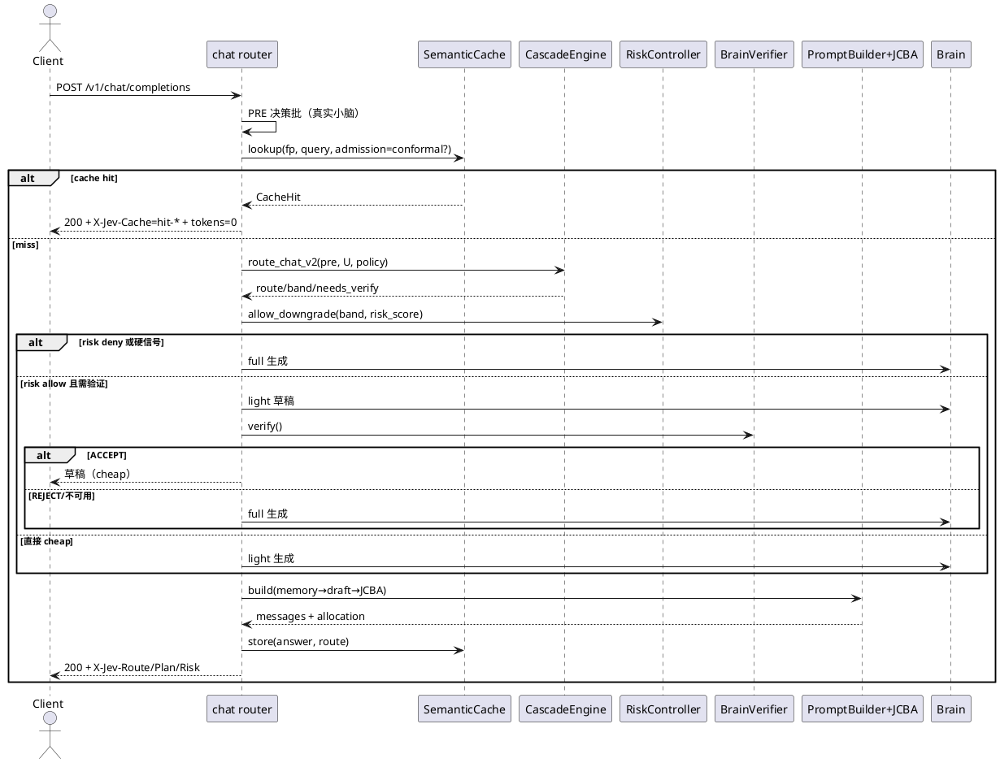
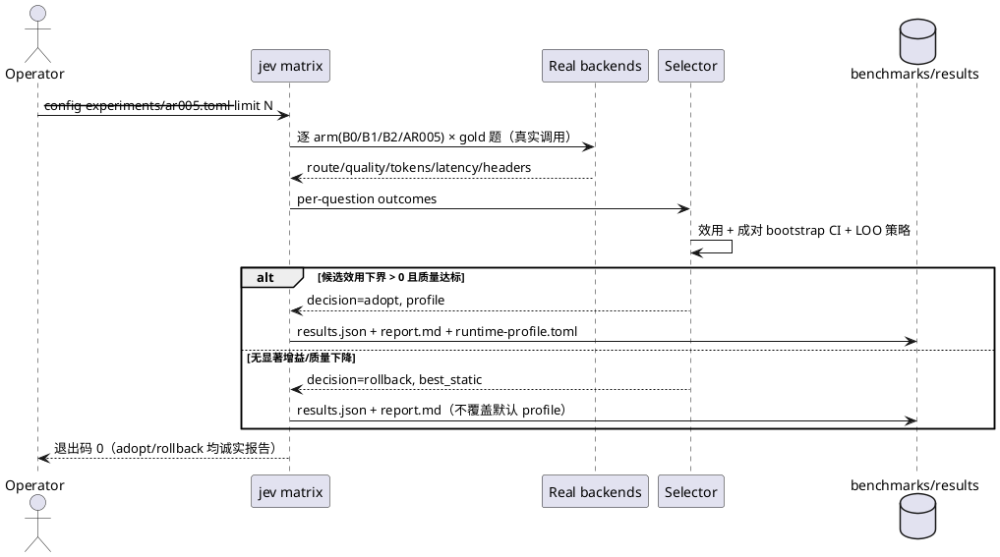
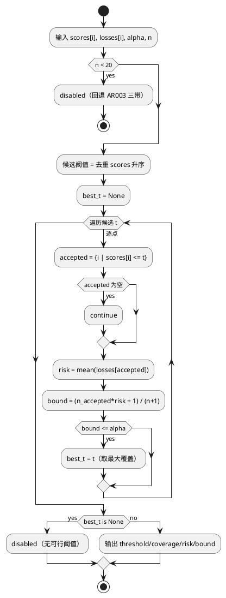
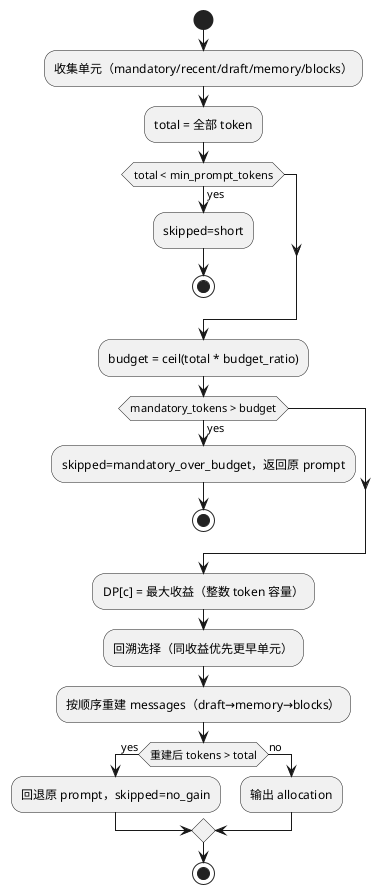
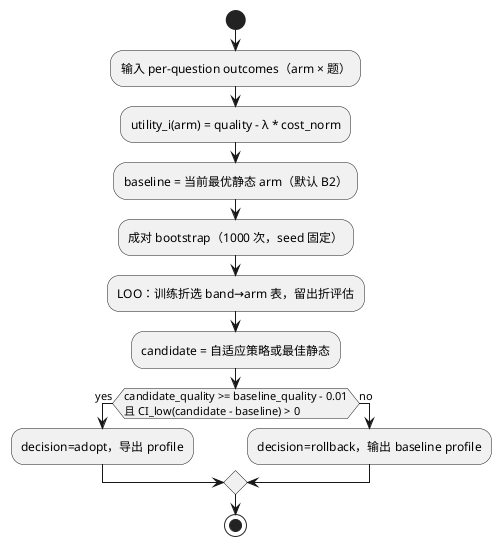

# 1 AR概述

| 组件名称 | Jev 端侧快慢双系统运行时 |
| --- | --- |
| AR系统流水号 | AR005 |
| AR描述 | 风险可控的自适应编排：Conformal 风险门/缓存准入、联合上下文预算分配（JCBA）、代价感知方案选择与自动回退、可复现实验矩阵与服务器大模型档 |

本 AR 在 AR002（能力门控路由）与 AR003（不确定性/验证器/缓存/prefill/记忆）之上，把「独立启发式开关」升级为**一个可校准、可解释、可回退的组合运行时**。核心不变式：

1. 任何降级必须经过风险门（校准或显式关闭），安全信号永远 full；
2. 任何 prompt 改写必须经过统一预算分配，组件不得各自超支；
3. 任何组合只有在真实 gold 集上相对上一最优有正效用下界时才被采纳，否则回退；
4. 所有指标来自真实后端，缺资产/缺采样一律失败或 `deferred-server`，绝不伪造。

# 2 动态行为

## 2.1 请求编排（风险门 + 缓存准入 + JCBA）



## 2.2 实验矩阵与选择/回退



# 3 功能点分解

| 序号 | 功能点名称 | 功能点描述 | 需求追溯 |
| --- | --- | --- | --- |
| 1 | Conformal 风险门 | 校准降级损失上界，替代固定 τ；失败安全 | FR5-1 |
| 2 | Conformal 缓存准入 | 负例控制假命中，正例保召回 | FR5-2 |
| 3 | JCBA 分配器 | 统一记忆/草稿/prefill 预算，确定性背包 | FR5-3 |
| 4 | 矩阵执行器 | 真实多方案跑 gold 集，产出原始 JSON/指纹 | FR5-4 |
| 5 | 方案选择与回退 | 效用/CI/LOO，无增益回退 | FR5-4 |
| 6 | 运行时接线与头/台账 | profile 启停、失败回退、只增响应头 | FR5-1/3/4 |
| 7 | 数据集与校验 | gold/缓存集 schema、客观判定 | FR5-2/4 |
| 8 | CLI 与服务器档 | `jev matrix`、7B/14B 配置、deferred 口径 | FR5-5 |
| 9 | 复现文档 | README/REPRODUCTION/EXPERIMENTS | FR5-5 |

# 4 实现设计

## 4.1 功能实现思路

**方案 A（采用）：离线校准 + 在线保守执行。** 用真实 gold/负例离线拟合风险门与缓存阈值，在线只做单调比较，不探索、不训练、不引入抖动；矩阵离线选择组合并导出 profile，生产按 profile 启用。相对方案 B（在线 bandit）避免质量抖动与不可复现；相对方案 C（纯固定阈值）具备统计边界与自动回退。

**方案 B（否决）：在线 UCB 探索。** 优点：自适应；缺点：生产质量不稳定、需要真实反馈闭环、实验不可复现，违背可靠性目标。
**方案 C（否决）：继续独立启发式。** 优点：改动小；缺点：无法证明降级安全，组件预算冲突，无法回答「组合最优」。

实现分四层：
1. **校准层** `runtime/conformal.py`：Conformal Risk Control（Angelopoulos et al.）阈值选择，支持「低分安全」与「高分安全」两种方向。
2. **分配层** `runtime/allocator.py`：0/1 背包 + 强制单元 + 确定性 tie-break。
3. **选择层** `bench/selector.py`：效用、配对 bootstrap、留一策略评估、adopt/rollback。
4. **编排层** `server/chat.py` + `kernel/kernel.py`：profile 装配、头/台账、失败安全。

## 4.2 功能实现设计

### 4.2.1 流程图

**（a）Conformal 风险门选择（downgrade 方向：s ≤ t 视为安全）**



**（b）JCBA 0/1 背包**



**（c）选择器 adopt/rollback**



### 4.2.2 流程说明

**风险门（downgrade）**
1. 风险分 `s = U`（[0,1]，越小越安全）。硬信号（`from_fallback`、`safety=unsafe`）先行 full，不查风险门。
2. 校准时 `losses[i]` 为「该请求走 cheap 相对 full 的质量损失」（gold 集 0/1 之差）；若校准集为参考质量，可用归一化错误率差。
3. 运行期单调判断 `s <= threshold` 才允许降级；`threshold` 来自 profile/校准文件。缺失/非法 → `RiskController.disabled()`，行为等价 AR003。
4. 台账 `runtime.risk = {mode, score, threshold, decision}`；响应头 `X-Jev-Risk: allow|deny|off`（只增）。

**缓存准入**
1. 校准集：`originals + paraphrases` 为正例，`negatives` 为负例；对每条算 embedding 与最近原句余弦。
2. 负例风险 = 负例被准入的比例；CRC 取最小阈值 `t` 满足 `(n_neg*risk+1)/(n_neg+1) ≤ α`，同时要求正例准入率 ≥ `min_recall`，否则回退固定阈值。
3. 运行期：`score ≥ t` 且 `best-second ≥ margin` 且 TTL 有效才命中；`CacheHit` 增 `admission/threshold` 元数据（默认不影响既有调用）。
4. 未校准/embedding 不可用 → 精确层（沿用 AR003）。

**JCBA**
1. 输入：原始 messages、记忆摘要（可选）、草稿前缀（可选）、prefill 块（可选）。
2. 各单元收益：mandatory=∞、最近 keep_turns 轮=1.0、memory=0.5、draft=0.4、块=显著性归一化（含位置微调）。
3. 预算只看 token，与模型 tokenizer 无关（确定性估算，沿用 AR003 `estimate_tokens`）；tie-break 按单元原始顺序。
4. 输出 `Allocation`（selected/omitted/saved/skipped）；prompt 组装顺序固定：draft→memory→blocks（保持 AR003 的顺序契约）。
5. 任一步异常 → 返回原 messages + `skipped`，由 chat 记录，不影响主路径。

**选择器**
1. 输入 JSON：`{arms: {name: {questions: {qid: {quality, tokens, latency_ms, band}}}}}`。
2. `cost_norm = tokens / max_tokens_across_arms`；`utility = quality - λ*cost_norm`；λ 默认 0.15。
3. 配对 bootstrap 以题为单位重采样，输出差值均值与 95% CI（固定 seed，可复现）。
4. LOO：按题留一，用其余题估计 band→arm 的最优映射，评估留出题；与最佳静态 arm 比较。样本 <20 或某 arm 缺失 → rollback。
5. profile 导出为 TOML；默认写 `benchmarks/results/<run>/profile.toml`，仅 `--write-profile` 时写 `configs/runtime-profile.toml`。

**矩阵执行**
1. 读取 experiment TOML（arms、模型、后端、λ、limit、seed）。
2. 每个 arm 用**独立 app/缓存/风险控制器**，同一真实 kernel（Laya）与同一真实 brain/embedding 服务；逐题串行，记录原始响应头与 usage。
3. gold 判定：`contains`/`regex`/`numeric`（容差），归一化大小写与空白；全自动。
4. 输出：`results.json`（schema v1，含指纹/命令/每 arm 每题原始指标）、`report.md`、`profile.toml`。
5. 后端不可用：异常上抛、退出码 2，不写 `adopt`。

## 4.3 接口描述

### 4.3.1 新增内部 API

```python
# jev.kernel.runtime.conformal
@dataclass(frozen=True)
class CalibrationResult:
    enabled: bool
    threshold: float | None
    coverage: float
    risk: float
    bound: float
    n: int
    alpha: float
    direction: str  # "le"（s<=t 安全）| "ge"（s>=t 安全）

def conformal_risk_threshold(
    scores: Sequence[float], losses: Sequence[float], *,
    alpha: float = 0.10, direction: str = "le", min_samples: int = 20,
) -> CalibrationResult

class RiskController:
    @classmethod
    def from_file(cls, path: Path | str, *, alpha: float = 0.10) -> "RiskController"
    @classmethod
    def disabled(cls) -> "RiskController"
    def allow_downgrade(self, score: float) -> bool
    @property
    def threshold(self) -> float | None
    def stats(self) -> dict
```

```python
# jev.kernel.runtime.allocator
@dataclass(frozen=True)
class Unit:
    key: str
    tokens: int
    benefit: float
    order: int
    mandatory: bool = False
    payload: object = None

@dataclass(frozen=True)
class Allocation:
    selected: tuple[str, ...]
    omitted: tuple[str, ...]
    before_tokens: int
    after_tokens: int
    skipped: str | None = None

@dataclass(frozen=True)
class AllocatorConfig:
    enabled: bool = False
    budget_ratio: float = 0.6
    min_prompt_tokens: int = 512
    min_blocks: int = 4
    draft_benefit: float = 0.4
    memory_benefit: float = 0.5

def allocate(units: Sequence[Unit], *, config: AllocatorConfig) -> Allocation
```

```python
# jev.bench.selector
@dataclass(frozen=True)
class ArmOutcome:            # 单题单 arm
    arm: str
    question_id: str
    quality: float           # 0/1
    tokens: int
    latency_ms: float
    band: str | None = None

@dataclass(frozen=True)
class SelectionResult:
    decision: str            # adopt | rollback
    chosen_arm: str
    baseline_arm: str
    utility: dict[str, float]
    delta_ci: tuple[float, float] | None
    policy: dict[str, str]   # band -> arm
    reason: str

def select(
    outcomes: Sequence[ArmOutcome], *,
    lambda_cost: float = 0.15, alpha: float = 0.05,
    baseline_arm: str = "B2", seed: int = 20261026, min_samples: int = 20,
) -> SelectionResult
```

### 4.3.2 配置增量（`configs/jev.toml`，全部默认关闭）

```toml
[runtime]
risk_control = false              # FR5-1；true 时读取 risk_calibration
risk_calibration = ""             # JSON 路径（矩阵产出）
risk_alpha = 0.10
allocator_enabled = false         # FR5-3
allocator_budget_ratio = 0.6
allocator_min_prompt_tokens = 512

[cache]
conformal_admission = false       # FR5-2
admission_calibration = ""        # JSON 路径
admission_alpha = 0.10
admission_min_recall = 0.60

[portfolio]
profile = ""                      # configs/runtime-profile.toml（空=不启用）
```

### 4.3.3 实验/数据 schema

`configs/experiments/ar005.toml`：
```toml
name = "ar005-local-1.5b"
seed = 20261026
lambda_cost = 0.15
limit = 0
brain = "spawn"                  # spawn | external
brain_base_url = ""              # external 时必填
embedding_base_url = ""          # 空=自动 spawn（真实 llama-server）
arms = ["B0", "B1", "B2", "AR005"]
[arm_configs.B1]
# 覆写 [runtime]/[cache]/[prefill] 的片段
```

`configs/quality-set.yaml`：
```yaml
version: 1
questions:
  - id: q-001
    lang: zh
    category: math | logic | factual | instruction
    prompt: "..."
    gold: {type: contains|regex|numeric, value: "4", tolerance: 0}
```

`configs/cache-set.yaml`：
```yaml
version: 1
originals:  [{id: o1, text: "..."}]
paraphrases: [{id: p1, of: o1, text: "..."}]
negatives:  [{id: n1, text: "..."}]
```

`benchmarks/results/<run>/results.json`：
```json
{
  "schema": "jev.matrix/1",
  "run": {"started": "", "commands": [], "fingerprint": {}},
  "config": {},
  "arms": {"B1": {"questions": {"q-001": {"route": "light", "quality": 1,
            "prompt_tokens": 12, "completion_tokens": 40, "latency_ms": 1200,
            "headers": {"X-Jev-Risk": "off"}}}}},
  "metrics": {}, "selection": {"decision": "rollback", "reason": "..."}
}
```

### 4.3.4 响应头（只增不改）

| 头 | 值 | 条件 |
| --- | --- | --- |
| `X-Jev-Risk` | `allow|deny|off` | runtime 启用且 profile 含风险门 |
| `X-Jev-Plan` | arm 名（如 `B2`/`AR005`） | profile 启用 |

`X-Jev-Route/Verified/Cache/Prefill/U` 语义不变。

## 4.4 代码设计

```text
src/jev/
├── kernel/
│   ├── runtime/
│   │   ├── conformal.py      新增：CRC 阈值、RiskController、缓存校准
│   │   ├── allocator.py      新增：Unit/Allocation/DP
│   │   ├── portfolio.py      新增：profile 读取/应用（纯数据）
│   │   └── prompt.py         修改：allocator 分支
│   ├── cache/semantic.py     修改：准入策略注入（不改默认行为）
│   └── kernel.py             修改：装配 RiskController/profile、属性、释放
├── server/chat.py            修改：风险门/allocator/头/台账，失败回退
├── bench/
│   ├── dataset.py            新增：gold/cache 集解析与校验
│   ├── matrix.py             新增：真实矩阵执行 + 报告
│   ├── selector.py           新增：bootstrap/LOO/adopt-rollback
│   └── report.py             修改：矩阵报告（复用现有渲染器）
└── cli/main.py               修改：`jev matrix`
configs/
├── quality-set.yaml          新增
├── cache-set.yaml            新增
├── runtime-profile.toml      生成（可入仓，默认 B2）
└── experiments/{ar005,b0,b1,b2,server-7b,server-14b}.toml
docs/{ARCHITECTURE,EXPERIMENTS}.md
REPRODUCTION.md
benchmarks/results/           gitignored（保留 .gitkeep 与样例报告）
```

依赖方向不变：`bench/cli → kernel`；`kernel.runtime` 不反向依赖 server。

# 5 重构设计

- 将 AR003 `plan_prefill` 的「首末块必选 + 预算选择」抽取为 JCBA 的一个候选来源；默认 `allocator_enabled=false` 时仍走原实现，保证逐例回归。
- 缓存命中元数据从 2 字段扩为 4 字段（`admission/threshold` 可选），默认值保持旧语义。
- 不删除任何既有公开接口；新增字段均有默认。

# 6 测试设计

## 6.1 单元测试（UT）

| 用例 | 覆盖 |
| --- | --- |
| CRC 单调/边界/样本不足/空集/NaN | FR5-1 |
| 风险门 allow/deny/disabled/硬信号 | FR5-1 |
| 缓存方向 ge 校准/不可行阈值/召回约束 | FR5-2 |
| JCBA 确定性/预算/强制单元/超预算/tie-break/短 prompt | FR5-3 |
| 选择器 adopt/rollback/CI/LOO/样本不足/arm 缺失 | FR5-4 |
| dataset 解析与 gold 判定（contains/regex/numeric） | FR5-4 |
| profile 解析与默认值 | FR5-4 |

## 6.2 接口测试

- `X-Jev-Risk`/`X-Jev-Plan` 仅在启用时出现；未启用时响应头与 AR003 完全一致。
- 校准文件缺失/损坏：启动或请求期回退，不 500。
- `jev matrix --limit 2` 退出码与 JSON schema；后端死亡 → 非 0。

## 6.3 业务场景测试（真实资产）

- gold 30 题四 arm 矩阵：质量/成本/延迟/命中率，生成报告与选择结论。
- 缓存：真实 embedding 下 10 负例误命中 ≤1、复述命中 ≥6。
- needles 40：JCBA vs 未压缩，prompt token ↓≥30% 且保留率下降 ≤2pt。
- 10 轮记忆：prompt token 线性增长上界与摘要质量抽查。
- 组合回退：构造候选劣于 B2 的 arm，断言 `rollback` 且 profile 不变。

## 6.4 异常场景测试

- brain/embedding 503/超时/解析失败 → full 或精确缓存，主路径不 500。
- 校准文件损坏、profile 非 TOML、参数越界 → 明确错误或回退。
- 矩阵中途后端退出 → 非 0 退出，不写 adopt。
- 服务器档资产缺失 → `deferred-server`/`JevAssetError`，不出假指标。
