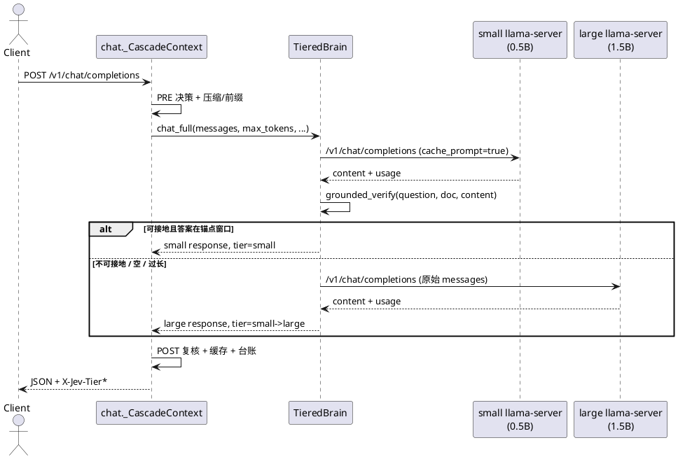
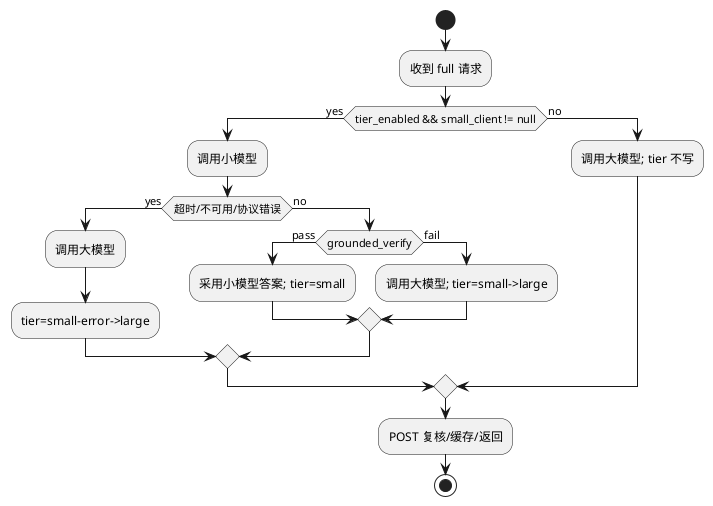
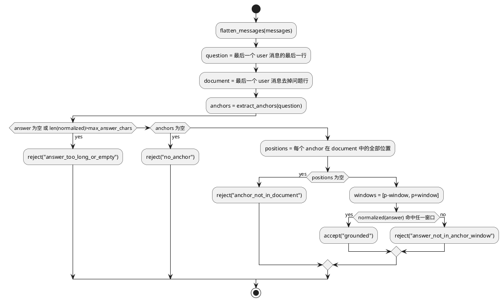

# [AR018] 详细设计说明书

# 1 AR概述

| 组件名称 | Jev 双系统内核 / 小脑-大脑编排 |
| --- | --- |
| AR 系统流水号 | AR018 |
| AR 描述 | GTB：证据接地的双脑级联；小模型先答，确定性接地验证通过即采用，否则升级大模型 |

设计输入：AR017 联合最优 `CGW_CASC_FAST + GPU offload`（P50 1.001s、tokens 1079、quality 1.0）。
真实探测表明 0.5B 在共享文档短抽取问答上 P50 约 497ms，但单独使用 shared 质量 0.75；
0.5B 正确答案可由“问题锚点邻域证据”验证，9/12 可安全接受、0 个错误答案被接受。

# 2 动态行为

## 2.1 full 路由级联时序



## 2.2 小模型异常回退



# 3 功能点分解

| 序号 | 功能点名称 | 功能点描述 | 对应需求 |
| --- | --- | --- | --- |
| 1 | 接地验证器 | 锚点/窗口/归一化/长度边界，纯函数 | FR18-3 |
| 2 | tier 配置 | `[cerebrum]` 平铺配置，默认关闭，fail-fast | FR18-1 |
| 3 | 小模型生命周期 | 独立 manager/端口/健康/关闭，失败不阻断 | FR18-2 |
| 4 | TieredBrain | full 首答、验证、升级、错误回退 | FR18-4 |
| 5 | 观测 | `X-Jev-Tier` / `X-Jev-Tier-Reason` | FR18-5 |
| 6 | 矩阵与质量回归 | 隔离/联合/needles/quality | FR18-6/7 |

# 4 实现设计

## 4.1 功能实现思路

采用**请求级双脑级联**，不改变 PRE/POST 决策与压缩协议：

1. 小模型与大模型是两个真实 llama-server 进程，分别持有 prefix/KV 缓存；
2. 仅 full 路由进入级联；light/streaming/POST 重试继续走大模型，避免不可回滚；
3. 接地验证完全确定性：从**问题行**提取锚点，在**文档部分**定位锚点，检查短答案是否在
   `±tier_ground_window` 字符窗口内；答案超长/为空/无锚点/无命中均升级；
4. 小模型失败不抛给用户，直接用大模型；小模型成功但验证失败也用大模型；
5. 默认关闭；实验 profile 显式开启。联合矩阵若无正收益，关闭并回退 AR017。

## 4.2 功能实现设计

### 4.2.1 流程图



### 4.2.2 流程说明

- `flatten_messages`：拼接 system/user/assistant 文本；以最后一条 user 消息为问题来源；
- 问题行：取 user 内容最后一行非空文本（兼容 `问题：...` 与普通问句）；
- 锚点规则（通用、无数据集硬编码）：
  1. 标识符 `[A-Za-z]{1,}[-_]\d{2,}`（如 `K-1005`）；
  2. 引号/书名号内片段（长度 ≥ 2）；
  3. 独立长数字（≥ 4 位）或英文词（≥ 4 字符，排除停用词）；
  4. 中文问题中长度 ≥ 2 的连续汉字片段（去掉常见疑问词）。
- 归一化：去空白、统一大小写、去首尾标点；同时保留原文子串匹配；
- 接受条件：`answer` 原文或归一化后出现在任一锚点窗口；
- 安全默认：任何异常（问题/文档为空、无锚点）→ reject → 升级大模型。

## 4.3 接口描述

### 4.3.1 新增模块

`src/jev/kernel/cerebrum/tiering.py`

```python
@dataclass(frozen=True)
class TierConfig:
    enabled: bool = False
    ground_window: int = 600
    max_answer_chars: int = 64
    small_model: Path | None = None
    small_gpu_layers: int = 0

@dataclass(frozen=True)
class GroundingResult:
    accepted: bool
    reason: str
    anchor: str | None = None

def grounded_verify(
    messages: list[dict[str, Any]],
    answer: str,
    *,
    window: int = 600,
    max_answer_chars: int = 64,
) -> GroundingResult: ...

class TieredBrain:
    def __init__(self, large: LlamaServerClient, small: LlamaServerClient,
                 config: TierConfig) -> None: ...
    def chat_full(self, messages, *, max_tokens, temperature, stop,
                  timeout_s) -> tuple[dict[str, Any], str, str]:
        """返回 (response, tier, reason)；response 结构与 LlamaServerClient.chat 一致。"""
```

### 4.3.2 Kernel 配置与生命周期

`[cerebrum]` 新增（全部可选）：

```toml
tier_enabled = false
small_model = "models/qwen/qwen2.5-0.5b-instruct-q4_k_m.gguf"
small_gpu_layers = 99
small_port = 0          # 0=自动空闲端口
tier_ground_window = 600
tier_max_answer_chars = 64
```

- Kernel 解析并校验（window>0、max_answer_chars>0、gpu_layers>=0）；
- `tier_enabled=true` 时 `_build_small_brain_manager` 用同一 llama-server 二进制、
  相同 ctx/host，独立端口；资产缺失 → `JevAssetError`；
- 暴露 `kernel.small_brain`、`kernel.tier_config`；`close()` 同步停止小模型；
- CLI `serve` 启动小模型，失败仅告警并置空（大模型继续服务）。

### 4.3.3 服务层接线

- `server/app.py`：若 `kernel.small_brain` 存在，构造 `LlamaServerClient`，
  再构造 `TieredBrain(large_client, small_client, kernel.tier_config)`；
- `create_chat_router(..., tiered_brain=None)`；`_CascadeContext` 保存；
- 仅 `_generate_full` 调用 `tiered_brain.chat_full`；成功时写入
  `last_runtime["decision"]["tier"]` 与 `tier_reason`；
- `_generate_light`/`_stream_response`/`_retry` 不变，继续 `context.brain`；
- `_route_headers` 追加 `X-Jev-Tier`、`X-Jev-Tier-Reason`（仅非流式且有值）。

### 4.3.4 矩阵支持

- `MatrixConfig` 新增 `small_brain_gguf: str`、`small_gpu_layers: int`；
- 每个 arm 若配置了小模型，则在同 arm 内启动小模型 manager，构造
  `TieredBrain` 并通过 `_build_client` 注入；
- arm 结束统一停止小模型，避免端口/显存残留；
- 新增 `gtb.toml`（CGW vs GTB 隔离）与 `gtb-casc.toml`（AGW_CASC / CGW_CASC /
  GTB_CACHE / GTB_CASC 联合）。

## 4.4 代码设计

```text
src/jev/kernel/cerebrum/
  tiering.py            # TierConfig / GroundingResult / grounded_verify / TieredBrain
  llama_server.py       # 不修改协议；复用 chat()
src/jev/kernel/
  kernel.py             # tier 配置、小模型 manager、属性与 close
src/jev/server/
  app.py                # 构造 TieredBrain 并注入
  chat.py               # _generate_full 分派、tier 观测头
src/jev/bench/
  matrix.py             # 小模型 arm 生命周期与 TieredBrain 注入
configs/
  jev.toml              # 默认关闭
  profiles/latency-best-gpu.toml  # 显式启用
  experiments/gtb.toml / gtb-casc.toml
tests/
  unit/test_tiering.py          # 纯逻辑 verifier/配置
  integration/test_tiered_brain_real.py  # 真实双 llama-server 级联
```

# 5 重构设计（可选）

无破坏性重构；`TieredBrain` 与 `LlamaServerClient` 保持鸭子类型，chat 层不感知两个进程。

# 6 测试设计

## 6.1 单元测试（UT）

- 锚点提取：标识符、引号、长数字、英文词、中文片段；
- 窗口命中/未命中、答案来自其它锚点、答案过长、空答案、无锚点；
- 归一化：空白/标点/大小写；
- 配置校验：默认关闭、非法 window/max_answer_chars/gpu_layers；
- `TierConfig` 与 Kernel 解析字段。

## 6.2 接口测试

- `TieredBrain.chat_full`：小模型成功接地、验证失败升级、小模型异常升级；
- 响应结构/usage 与 `LlamaServerClient.chat` 一致；
- 非 full/streaming 不经过级联（静态断言/行为测试）。

## 6.3 业务场景测试

- 真实 shared-prefix 12 题：CGW_CASC vs GTB_CASC，quality/P50/mean/tokens；
- needles 12 题：0.5B 接地接受率与质量；
- quality 数据集：不可接地答案必须升级，质量不降。

## 6.4 异常场景测试

- 小模型进程停止/端口不可达：返回大模型结果，无 5xx；
- 小模型超时：大模型在剩余 deadline 内完成或按 EX-04 降级；
- 小模型资产缺失：启动 fail-fast（`JevAssetError`）；
- 进程清理：矩阵 arm 结束与 Kernel.close 无残留 llama-server。
