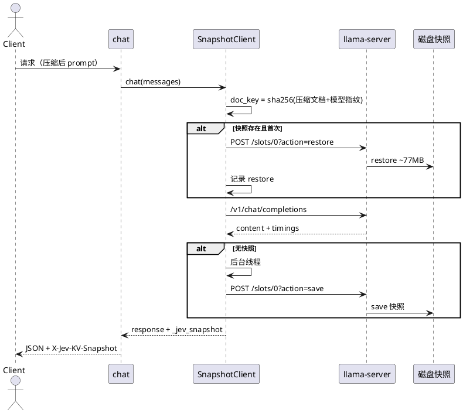
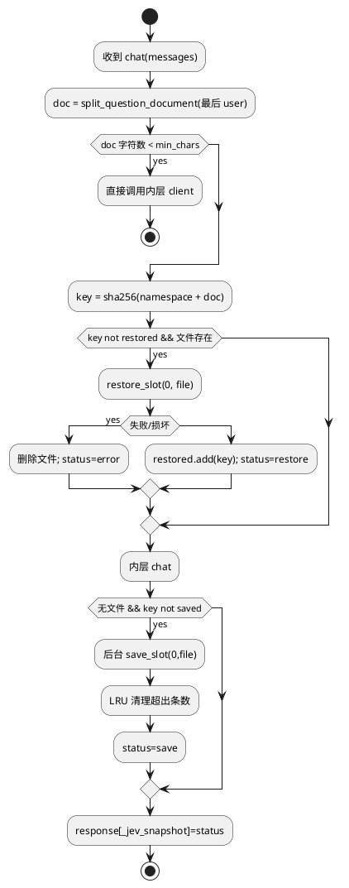

# [AR019] 详细设计说明书

# 1 AR概述

| 组件名称 | Jev 大脑服务 / 前缀 KV 持久化 |
| --- | --- |
| AR 系统流水号 | AR019 |
| AR 描述 | PPKS：以压缩文档+模型指纹为键，真实保存/恢复 llama-server slot KV，降低重启后首请求 prefill |

# 2 动态行为



# 3 功能点分解

| 序号 | 功能点 | 描述 | 需求 |
| --- | --- | --- | --- |
| 1 | 配置 | 目录/条数/最小字符/slot | FR19-1 |
| 2 | API | save/restore/slots | FR19-2 |
| 3 | 文档键客户端 | 键、异步保存、LRU、兜底 | FR19-3/4 |
| 4 | 接线 | Kernel/app/matrix/header | FR19-4 |
| 5 | 冷重启实验 | 真实启停对照 | FR19-5 |

# 4 实现设计

## 4.1 思路

llama-server 的 slot 快照包含当前 prompt 的 KV。保存时记录“压缩后文档 + 首个问题”，
恢复后发送同文档的新问题，llama-server 的 prompt cache 会复用文档前缀，只 prefill 新问题。
快照只在首次请求后异步保存，稳态请求不重复 save/restore；恢复只对同文档首次请求执行。

## 4.2 流程图



## 4.3 接口

```python
@dataclass(frozen=True)
class SnapshotConfig:
    enabled: bool = False
    directory: Path | None = None
    max_entries: int = 4
    min_chars: int = 1000
    slot_id: int = 0

class SnapshotClient:
    def __init__(self, inner: LlamaServerClient, config: SnapshotConfig,
                 namespace: str) -> None: ...
    def chat(self, messages, *, max_tokens, temperature, stop, timeout_s) -> dict: ...
    def chat_stream(self, ...) -> Iterator[dict]: ...  # 不启用快照，直接透传
    def close(self) -> None: ...
```

`LlamaServerManager(slot_save_path=...)` 追加 `--slot-save-path` 与 `--slots`。
`LlamaServerClient.slot_save/restore/slots` 通过真实 HTTP 调用。

## 4.4 代码设计

```text
src/jev/kernel/cerebrum/
  llama_server.py   # manager 参数 + slot API
  snapshot.py       # SnapshotConfig / SnapshotClient
src/jev/kernel/kernel.py   # 配置解析、namespace、manager 接线
src/jev/server/app.py      # 包装 large/small clients
src/jev/server/chat.py     # 记录 X-Jev-KV-Snapshot
src/jev/bench/matrix.py    # kv_snapshot_dir 与包装
scripts/bench_ppks.py      # 真实冷重启实验
tests/unit/test_snapshot.py
tests/integration/test_ppks_real.py
configs/jev.toml / profiles / experiments/ppks.toml
```

# 5 重构设计

无；`SnapshotClient` 对 chat 层是 LlamaServerClient 的透明包装。

# 6 测试设计

## 6.1 单元测试

- 配置校验/默认关闭；文档键稳定性；短文档跳过；LRU 清理；损坏文件删除；
- 使用真实 HTTP 的客户端 API 在集成测试验证，不用 mock 代替端到端。

## 6.2 接口测试

- save 返回 n_saved>0；restore 返回 n_restored>0；
- 同文档新问题 restore 后 prompt_n 明显下降。

## 6.3 业务场景

- shared-prefix 冷启动 baseline vs PPKS；
- 开启快照后稳态 P50 不退化（首请求除外）。

## 6.4 异常场景

- 快照文件截断/不可读 → 删除并正常 prefill；
- 目录不可写 → 退化为无快照；
- 服务重启/端口不可达 → 正常请求路径 5xx 语义不变。
