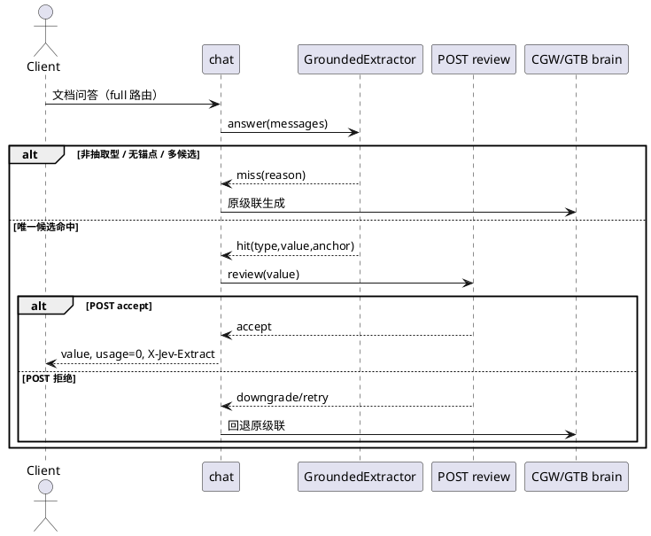
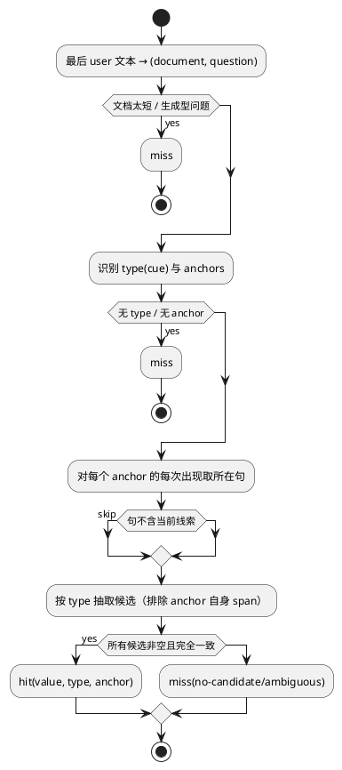

# [AR020] 详细设计说明书

# 1 AR概述

| 组件名称 | Jev 文档问答快路径 |
| --- | --- |
| AR 系统流水号 | AR020 |
| AR 描述 | GEXA：在 full 路由前做确定性、锚点接地、唯一候选的抽取式快答，命中时零大脑调用 |

# 2 动态行为



# 3 功能点分解

| 序号 | 功能点 | 描述 | 需求 |
| --- | --- | --- | --- |
| 1 | 配置 | 开关、文档长度、答案长度、锚点次数 | FR20-1 |
| 2 | 识别 | 拆分、锚点、类型、线索、非抽取负向门 | FR20-2 |
| 3 | 抽取 | 邻近句、类型 regex、排除锚点、唯一性 | FR20-3 |
| 4 | 组合 | chat full 前置、POST、header、回退 | FR20-4 |
| 5 | 实验 | 矩阵 arm、真实数据集 | FR20-5 |

# 4 实现设计

## 4.1 思路

抽取式问题的答案通常与问题锚点出现在**同一句**，且句子包含答案类型线索。
因此不需要模型：定位锚点 → 取所在句 → 只按答案类型抽取 → 排除锚点自身 →
所有命中句候选必须完全一致 → 输出原值。任何不确定都 miss。

## 4.2 流程图



## 4.3 接口

```python
@dataclass(frozen=True)
class ExtractiveConfig:
    enabled: bool = False
    min_document_chars: int = 200
    max_answer_chars: int = 64
    max_anchor_occurrences: int = 64

@dataclass(frozen=True)
class ExtractionResult:
    hit: bool
    answer: str = ""
    kind: str = ""
    anchor: str = ""
    reason: str = ""

class GroundedExtractor:
    def __init__(self, config: ExtractiveConfig) -> None: ...
    @property
    def enabled(self) -> bool: ...
    def answer(self, messages: list[dict[str, Any]]) -> ExtractionResult: ...
```

`create_chat_router(..., extractor: GroundedExtractor | None = None)`；
`_CascadeContext.extractor`；`Kernel.extractor`；`build_serve_app` 注入；
`bench/matrix._build_client` 注入 arm 级 extractor。

## 4.4 代码设计

```text
src/jev/kernel/extract/grounded.py   配置/结果/抽取器（纯确定性）
src/jev/kernel/kernel.py              [extractive] → Kernel.extractor
src/jev/server/app.py                 注入 create_chat_router
src/jev/server/chat.py                full 前置快答 + POST + X-Jev-Extract
src/jev/bench/matrix.py               arm 级 extractive 接线
tests/unit/test_grounded_extractor.py
tests/unit/test_chat_extractive.py
tests/integration/test_extractive_real.py
configs/experiments/extractive.toml
```

# 5 重构设计

不改变 `_generate_full`/级联签名；抽取是 `_handle_chat_cascade` 的前置分支，
miss 后完全复用原逻辑。

# 6 测试设计

## 6.1 单元测试

- shared 12/12、needles 30/30、quality 0、generation 0（真实数据集）；
- 干扰句同锚点但候选不同 → ambiguous；
- 日期类型、答案超长、非抽取动词、空文档；
- chat：命中不调用 brain；POST 拒绝回退；miss 不改语义；header。

## 6.2 接口测试

- `X-Jev-Extract: hit:numeric` / miss 无头；
- 命中 usage=0；brain stub 调用次数 0（单测确定性桩，不冒充真实后端）。

## 6.3 业务场景

- 真实 Laya + 不启动 llama-server：抽取命中仍成功，证明零大脑依赖；
- 真实矩阵：B1/CGW/GTB/GEXA，shared 与 needles；
- 无命中数据集质量不下降。

## 6.4 异常场景

- 多候选/无候选/生成型 → miss；
- POST 拒绝 → 回退；
- 抽取器异常 → 捕获后 miss，不影响请求。
